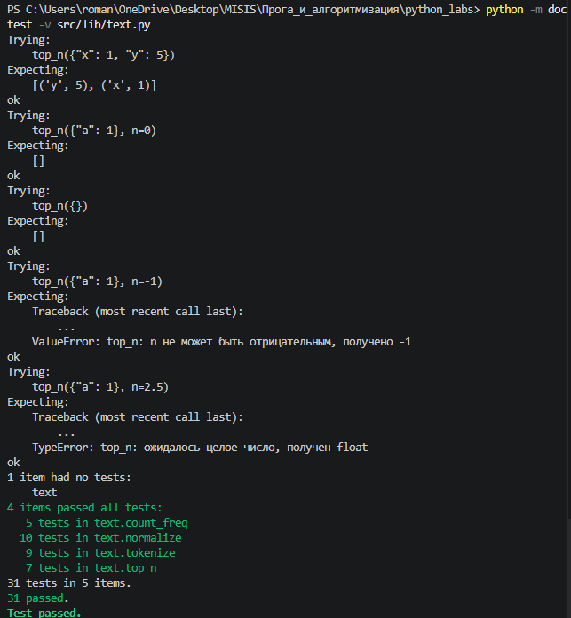
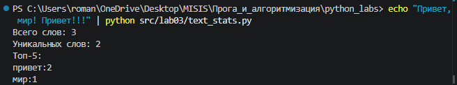
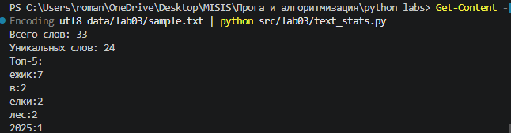
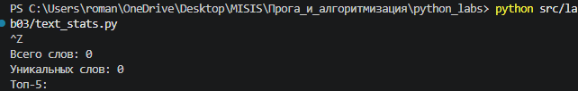
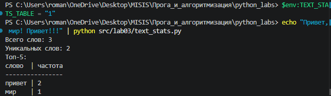
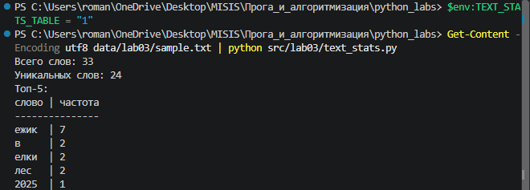

## ЛР3 — Тексты и частоты слов

Нормализация текста, токенизация регулярным выражением, подсчёт частот слов словарём и вывод топ-N. Функции вынесены в переиспользуемый модуль [`src/lib/text.py`](../lib/text.py), который будет импортироваться в следующих лабораторных работах. Используется только стандартная библиотека.

| № | Задание | Файл | Содержимое |
|---|---------|------|------------|
| A | Модуль обработки текста | [`src/lib/text.py`](../lib/text.py) | `normalize`, `tokenize`, `count_freq`, `top_n` |
| B | Скрипт статистики | [`text_stats.py`](text_stats.py) | `main` — чтение stdin и вывод статистики |
| ★ | Табличный вывод | [`text_stats.py`](text_stats.py) | `print_table`, `is_table_mode` |

Конвейер обработки:

```text
stdin → normalize → tokenize → count_freq → top_n → печать
```

### Запуск

Все команды выполняются из корня репозитория.

```bash
# задание B: текст через пайп
echo "Привет, мир! Привет!!!" | python src/lab03/text_stats.py

# задание B: текст из файла (PowerShell)
Get-Content -Encoding utf8 data/lab03/sample.txt | python src/lab03/text_stats.py

# задание ★: табличный вывод (PowerShell)
$env:TEXT_STATS_TABLE = "1"
echo "Привет, мир! Привет!!!" | python src/lab03/text_stats.py

# задание A: проверка всех примеров из docstring
python -m doctest -v src/lib/text.py
```

Все функции модуля чистые: не читают ввод, ничего не печатают и не изменяют аргументы, а возвращают новый объект. При неверном типе аргумента выбрасывается `TypeError`, при отрицательном `n` в `top_n` — `ValueError`.

---

### Задание A — `src/lib/text.py`

#### `normalize(text, *, casefold=True, yo2e=True)`

Приводит текст к единому виду, чтобы одинаковые слова стали одинаковыми строками:

1. Регистр опускается через `casefold()`, при `casefold=False` — через `lower()`. `casefold` предназначен для сравнения строк и сильнее `lower`: например, `"Straße".casefold()` → `"strasse"`, а `"Straße".lower()` → `"straße"`. Для русского текста результаты совпадают.
2. При `yo2e=True` буква `ё` заменяется на `е`. Заглавная `Ё` к этому моменту уже стала строчной. Замена нужна, чтобы «ёжик» и «ежик» считались одним словом, и чтобы не ломался алфавитный порядок: в Unicode `ё` (1105) стоит после `я` (1103).
3. `" ".join(text.split())` — `split()` без аргумента режет по любым пробельным символам (`\t`, `\r`, `\n`, неразрывный пробел) и отбрасывает пустые куски, а `join` склеивает слова через один пробел. Это одновременно заменяет управляющие символы, схлопывает повторы и обрезает края.

Строки неизменяемы, поэтому результат каждого метода присваивается заново: `text = text.casefold()`.

Флаги после `*` передаются только по имени: `normalize(t, yo2e=False)`.

```python
def normalize(text: str, *, casefold: bool = True, yo2e: bool = True) -> str:
    if not isinstance(text, str):
        raise TypeError(f"normalize: ожидалась строка, получен {type(text).__name__}")
    if casefold:
        text = text.casefold()
    else:
        text = text.lower()
    if yo2e:
        text = text.replace("ё", "е")
    return " ".join(text.split())
```

#### `tokenize(text)`

Возвращает список слов в порядке появления. Слово описывается регулярным выражением `\w+(?:-\w+)*`:

- `\w+` — одна или больше букв любого алфавита, цифр или `_`;
- `(?:-\w+)*` — ноль или больше «хвостов» из дефиса и букв, то есть дефис допускается только **внутри** слова (`по-настоящему` — одно слово, `-да-` → `да`);
- `(?:...)` — незахватывающая группа: с обычной `(...)` функция `re.findall` вернула бы содержимое группы, а не слово целиком;
- шаблон записан raw-строкой `r"..."`, чтобы Python не обрабатывал `\` сам.

Пунктуация, длинное тире `—` и эмодзи в слова не попадают. Регистр и `ё` функция не трогает — предполагается, что текст уже нормализован.

```python
import re

WORD_PATTERN = r"\w+(?:-\w+)*"


def tokenize(text: str) -> list[str]:
    if not isinstance(text, str):
        raise TypeError(f"tokenize: ожидалась строка, получен {type(text).__name__}")
    return re.findall(WORD_PATTERN, text)
```

#### `count_freq(tokens)`

Считает частоты за один проход по списку. `freq.get(token, 0)` возвращает текущий счёт, а для слова, которое встретилось впервые, — `0`, поэтому `KeyError` не возникает. Поиск по ключу в словаре работает за O(1) благодаря хеш-таблице. Ключи идут в порядке первого появления слова.

```python
def count_freq(tokens: list[str]) -> dict[str, int]:
    if not isinstance(tokens, list):
        raise TypeError(f"count_freq: ожидался список, получен {type(tokens).__name__}")
    freq: dict[str, int] = {}
    for token in tokens:
        freq[token] = freq.get(token, 0) + 1
    return freq
```

#### `top_n(freq, n=5)`

Сортирует пары `(слово, частота)` по ключу `(-частота, слово)`. Кортежи сравниваются поэлементно: минус перед частотой даёт убывание, а при равной частоте слова идут по алфавиту. `reverse=True` здесь не подходит — он развернул бы и алфавитный порядок. Срез `[:n]` берёт первые `n` пар; если слов меньше — возвращаются все. Отрицательное `n` запрещено: срез `[:-1]` молча вернул бы неверный результат.

```python
def top_n(freq: dict[str, int], n: int = 5) -> list[tuple[str, int]]:
    if not isinstance(freq, dict):
        raise TypeError(f"top_n: ожидался словарь, получен {type(freq).__name__}")
    if not isinstance(n, int):
        raise TypeError(f"top_n: ожидалось целое число, получен {type(n).__name__}")
    if n < 0:
        raise ValueError(f"top_n: n не может быть отрицательным, получено {n}")
    return sorted(freq.items(), key=lambda p: (-p[1], p[0]))[:n]
```

#### Тесты

У каждой функции в docstring есть примеры: все тест-кейсы из задания, а также граничные случаи (пустой ввод, флаги `normalize`, дефисы по краям слова, длинное тире, `n=0`, ошибки типов). Всего 31 проверка, все проходят.

| Функция | Вход | Результат |
|---------|------|-----------|
| `normalize` | `"ПрИвЕт\nМИр\t"` | `"привет мир"` |
| `normalize` | `"ёжик, Ёлка"` | `"ежик, елка"` |
| `normalize` | `"Hello\r\nWorld"` | `"hello world"` |
| `normalize` | `"  двойные   пробелы  "` | `"двойные пробелы"` |
| `tokenize` | `"hello,world!!!"` | `["hello", "world"]` |
| `tokenize` | `"по-настоящему круто"` | `["по-настоящему", "круто"]` |
| `tokenize` | `"2025 год"` | `["2025", "год"]` |
| `tokenize` | `"emoji 😀 не слово"` | `["emoji", "не", "слово"]` |
| `count_freq` | `["a","b","a","c","b","a"]` | `{"a": 3, "b": 2, "c": 1}` |
| `top_n` | `{"a": 3, "b": 2, "c": 1}`, `n=2` | `[("a", 3), ("b", 2)]` |
| `top_n` | `{"aa": 2, "bb": 2, "cc": 1}`, `n=2` | `[("aa", 2), ("bb", 2)]` |



*Рис. 1. `python -m doctest -v src/lib/text.py` — все 31 пример проходят.*

---

### Задание B — `text_stats.py`

Скрипт читает **весь ввод до EOF** через `sys.stdin.read()`, а не одну строку через `input()`: так обрабатывается многострочный текст, а пустой ввод не вызывает `EOFError`. Текст проходит через четыре функции модуля, затем печатаются общее число слов (`len(words)`), число уникальных (`len(frequencies)`) и топ-5 в формате `слово:кол-во`.

При запуске `python src/lab03/text_stats.py` Python ищет модули в папке скрипта (`src/lab03`), где нет `lib`. Поэтому перед импортом в `sys.path` добавляется папка `src`, вычисленная от расположения файла — скрипт работает из любой текущей папки. Импорт стоит после кода намеренно, это отмечено `# noqa: E402`.

Число 5 вынесено в константу `TOP_COUNT`: оно используется и в вызове `top_n`, и в заголовке «Топ-5».

Первая строка `main()` — `sys.stdin.reconfigure(encoding="utf-8")`. Без неё на Windows Python читает stdin в кодировке системы (cp1251), а PowerShell передаёт текст в UTF-8. Каждая русская буква в UTF-8 занимает 2 байта, и при чтении в cp1251 разваливается на два символа: «Привет» превращалось в `Привет`, а в топе появлялось `рџсђрерірμс:2`. Явное указание кодировки делает скрипт независимым от настроек терминала.

Функции `is_table_mode`, `print_list` и `print_table` относятся к заданию ★ и описаны ниже.

```python
import os
import sys
from pathlib import Path

sys.path.insert(0, str(Path(__file__).resolve().parent.parent))
from lib.text import count_freq, normalize, tokenize, top_n  # noqa: E402

TOP_COUNT = 5
TABLE_ENV_VAR = "TEXT_STATS_TABLE"
WORD_HEADER = "слово"
COUNT_HEADER = "частота"
COLUMN_SEPARATOR = " | "


def is_table_mode() -> bool:
    return os.environ.get(TABLE_ENV_VAR, "0") == "1"


def print_list(ranked: list[tuple[str, int]]) -> None:
    for word, count in ranked:
        print(f"{word}:{count}")


def print_table(ranked: list[tuple[str, int]]) -> None:
    width = max([len(WORD_HEADER)] + [len(word) for word, _ in ranked])
    header = f"{WORD_HEADER:<{width}}{COLUMN_SEPARATOR}{COUNT_HEADER}"
    print(header)
    print("-" * len(header))
    for word, count in ranked:
        print(f"{word:<{width}}{COLUMN_SEPARATOR}{count}")


def main() -> None:
    sys.stdin.reconfigure(encoding="utf-8")
    text = sys.stdin.read()

    normalized = normalize(text)
    words = tokenize(normalized)
    frequencies = count_freq(words)
    ranked = top_n(frequencies, TOP_COUNT)

    print(f"Всего слов: {len(words)}")
    print(f"Уникальных слов: {len(frequencies)}")
    print(f"Топ-{TOP_COUNT}:")
    if is_table_mode():
        print_table(ranked)
    else:
        print_list(ranked)


if __name__ == "__main__":
    main()
```

#### Пример 1 — из задания

```text
$ echo "Привет, мир! Привет!!!" | python src/lab03/text_stats.py
Всего слов: 3
Уникальных слов: 2
Топ-5:
привет:2
мир:1
```



*Рис. 2. Пример из задания.*

#### Пример 2 — многострочный текст из файла

Файл [`data/lab03/sample.txt`](../../data/lab03/sample.txt): несколько строк с табуляцией, буквами `ё`/`Ё` в разном регистре, словами через дефис, длинным тире, числом, кавычками-ёлочками и эмодзи.

```text
Всего слов: 33
Уникальных слов: 24
Топ-5:
ежик:7
в:2
елки:2
лес:2
2025:1
```

Все формы «Ёжик», «ёжик», «Ежик» посчитаны как одно слово `ежик`. Слова с равной частотой (`в`, `елки`, `лес`) идут по алфавиту. `2025` стоит раньше букв, потому что цифры в Unicode имеют меньшие номера.



*Рис. 3. Многострочный текст из файла.*

#### Пример 3 — пустой ввод

```text
Всего слов: 0
Уникальных слов: 0
Топ-5:
```



*Рис. 4. Пустой ввод обрабатывается без ошибок.*

---

### Задание ★ — табличный вывод

Топ можно вывести выровненной таблицей. Режим включается переменной окружения `TEXT_STATS_TABLE=1`, по умолчанию выводится обычный список `слово:кол-во` — так формат задания B не меняется.

- `is_table_mode()` читает переменную через `os.environ.get(TABLE_ENV_VAR, "0")`: если переменной нет, берётся `"0"` и режим выключен.
- `print_table()` считает ширину столбца как длину самого длинного слова в топе, но не меньше длины заголовка «слово», иначе для коротких слов заголовок вылез бы за столбец. Слово выравнивается по левому краю вложенным форматом `f"{word:<{width}}"` — ширина подставляется из переменной.
- Длина линии из дефисов равна длине строки заголовка, поэтому она всегда совпадает с шириной таблицы.
- Заголовки и разделитель столбцов вынесены в константы.

Код — в листинге задания B выше (функции `is_table_mode`, `print_table`).

#### Пример 4 — таблица на примере из задания

```text
PS> $env:TEXT_STATS_TABLE = "1"
PS> echo "Привет, мир! Привет!!!" | python src/lab03/text_stats.py
Всего слов: 3
Уникальных слов: 2
Топ-5:
слово  | частота
----------------
привет | 2
мир    | 1
```



*Рис. 5. Табличный вывод: ширина столбца — по слову «привет».*

#### Пример 5 — таблица на тексте из файла

```text
Всего слов: 33
Уникальных слов: 24
Топ-5:
слово | частота
---------------
ежик  | 7
в     | 2
елки  | 2
лес   | 2
2025  | 1
```

Самое длинное слово в топе — `ежик` (4 символа), короче заголовка, поэтому ширина столбца равна длине слова «слово».



*Рис. 6. Табличный вывод для `data/lab03/sample.txt`.*

Выключить табличный режим: `Remove-Item Env:TEXT_STATS_TABLE` (или закрыть окно PowerShell).
