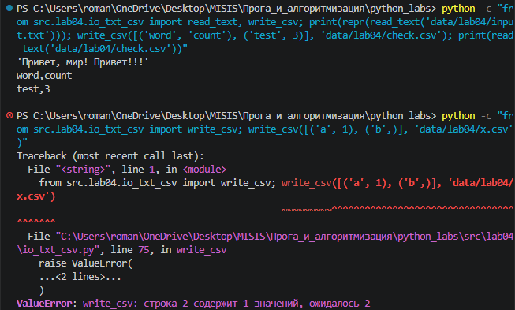
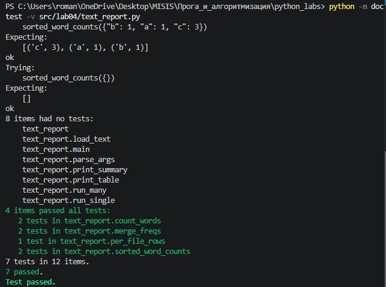
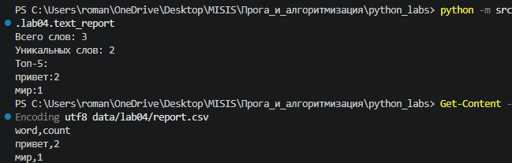
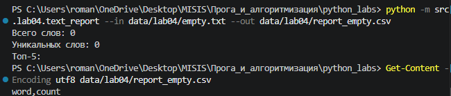
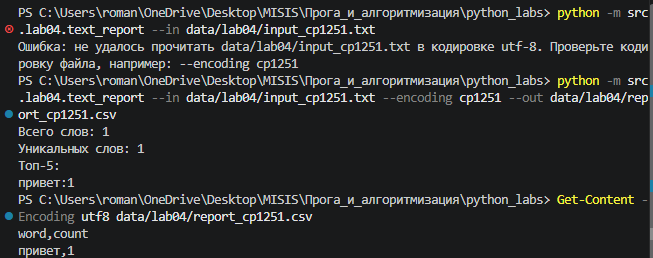
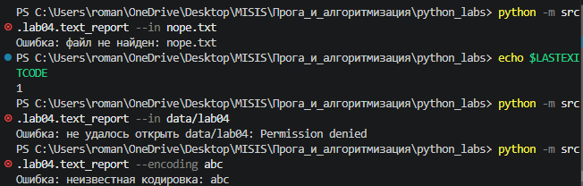
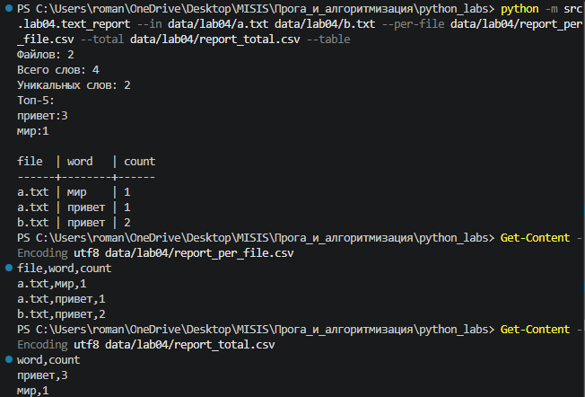
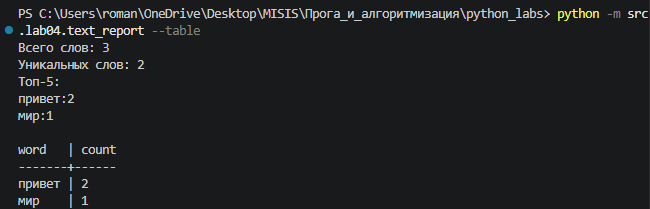

## ЛР4 — Файлы: TXT/CSV и отчёты по текстовой статистике

Чтение текстовых файлов в заданной кодировке, подсчёт частот слов и выгрузка отчётов в CSV. Подсчёт слов переиспользует модуль [`src/lib/text.py`](../lib/text.py) из ЛР3, ввод/вывод вынесен в отдельный модуль [`io_txt_csv.py`](io_txt_csv.py), который понадобится в следующих лабораторных. Используется только стандартная библиотека (`csv`, `pathlib`, `argparse`, `sys`).

| № | Задание | Файл | Содержимое |
|---|---------|------|------------|
| A | Модуль ввода/вывода | [`io_txt_csv.py`](io_txt_csv.py) | `read_text`, `write_csv`, `ensure_parent_dir` |
| B | Скрипт отчёта | [`text_report.py`](text_report.py) | `count_words`, `sorted_word_counts`, `print_summary`, `load_text`, `run_single`, `main` |
| ★ | Несколько файлов и таблица | [`text_report.py`](text_report.py) | `merge_freqs`, `per_file_rows`, `print_table`, `run_many` |

Конвейер обработки:

```text
файл → read_text → normalize → tokenize → count_freq → сортировка → write_csv → report.csv
                                                              ↘ print_summary → консоль
```

Логика и ввод/вывод разделены: функции подсчёта (`count_words`, `sorted_word_counts`, `merge_freqs`, `per_file_rows`) чистые — не читают файлы и ничего не печатают, поэтому проверяются через doctest. Работа с диском — только в `io_txt_csv.py`, обработка ошибок для пользователя — только в `load_text`.

### Запуск

Все команды выполняются **из корня репозитория** и **как модуль** (`python -m`). При запуске по пути к файлу (`python src/lab04/text_report.py`) Python кладёт в `sys.path` папку скрипта `src/lab04`, откуда не виден пакет `src`, и импорт падает с `ModuleNotFoundError`. При `-m` в `sys.path` попадает текущая папка — корень, откуда видны и `src.lib.text`, и `data/`. Относительные пути к файлам тоже считаются от текущей папки, а не от папки скрипта.

```bash
# задание B: все параметры по умолчанию (data/lab04/input.txt → data/lab04/report.csv)
python -m src.lab04.text_report

# задание B: свои пути
python -m src.lab04.text_report --in data/lab04/input.txt --out data/lab04/report.csv

# задание B: файл не в UTF-8
python -m src.lab04.text_report --in data/lab04/input_cp1251.txt --encoding cp1251

# задание ★: несколько файлов — отчёт по каждому и сводный
python -m src.lab04.text_report --in data/lab04/a.txt data/lab04/b.txt --per-file data/lab04/report_per_file.csv --total data/lab04/report_total.csv

# задание ★: дополнительно вывести отчёт таблицей
python -m src.lab04.text_report --table

# справка по параметрам
python -m src.lab04.text_report --help

# проверка всех примеров из docstring
python -m doctest -v src/lab04/text_report.py
```

| Параметр | По умолчанию | Назначение |
|----------|--------------|------------|
| `--in` | `data/lab04/input.txt` | один или несколько входных файлов |
| `--out` | `data/lab04/report.csv` | отчёт `word,count` для одного файла |
| `--per-file` | `data/lab04/report_per_file.csv` | ★ отчёт `file,word,count` |
| `--total` | `data/lab04/report_total.csv` | ★ сводный отчёт `word,count` |
| `--encoding` | `utf-8` | кодировка входных файлов |
| `--table` | выключен | напечатать отчёт выровненной таблицей |

Режим выбирается автоматически: один файл — базовый (используется `--out`), больше одного файла или указан `--per-file`/`--total` — режим ★ (`--out` не используется).

В отличие от примеров в задании, файлы лабораторной лежат в `data/lab04/`, а не в `data/`, чтобы данные разных лабораторных не смешивались.

PowerShell, в отличие от bash, не раскрывает шаблоны вида `data/lab04/*.txt` — в программу придёт буквальная строка со звёздочкой. Входные файлы нужно перечислять явно.

### Тестовые данные

| Файл | Содержимое | Для чего |
|------|------------|----------|
| [`input.txt`](../../data/lab04/input.txt) | `Привет, мир! Привет!!!` | тест-кейс A |
| [`empty.txt`](../../data/lab04/empty.txt) | пустой | тест-кейс B |
| [`input_cp1251.txt`](../../data/lab04/input_cp1251.txt) | `Привет` в кодировке cp1251 | тест-кейс C |
| [`a.txt`](../../data/lab04/a.txt), [`b.txt`](../../data/lab04/b.txt) | `Привет мир`, `Привет, привет!` | тест-кейс D★ |

---

### Задание A — `io_txt_csv.py`

#### `read_text(path, encoding="utf-8")`

Открывает файл через `with` и возвращает его содержимое одной строкой. `with` закрывает файл в любом случае, даже если внутри произошла ошибка. Пустой файл даёт пустую строку `""`.

Ошибки **не перехватываются**: `FileNotFoundError` (нет файла), `UnicodeDecodeError` (байты не читаются в указанной кодировке) и `LookupError` (нет такой кодировки) передаются вызывающему коду. Функция не знает, где её используют — в консольной программе, в тесте или в другой лабораторной, — поэтому решение, что делать с ошибкой, принимает вызывающий код. В этой работе это `load_text` в `text_report.py`.

Файл читается целиком через `f.read()` — для учебных файлов в пару килобайт это проще всего. Для больших файлов в реальной задаче лучше читать построчно (`for line in f`): тогда в памяти одновременно находится одна строка, а не весь текст и все слова сразу.

#### `write_csv(rows, path, header=None)`

1. **Проверка длины строк — до открытия файла.** Эталон длины — `header`, а если его нет — первая строка. Строка другой длины даёт `ValueError` с номером строки. Проверка стоит до `open`, потому что режим `"w"` стирает файл в момент открытия: при ошибке в данных старый отчёт остаётся нетронутым.
2. **Создание папок** через `ensure_parent_dir`: `open` в режиме `"w"` создаёт файл, но не папки.
3. **Запись** модулем `csv`. В отличие от склейки через `",".join(...)`, `csv.writer` сам ставит кавычки, если внутри значения есть запятая (`"Иванов, Иван",92`), и сам превращает числа в строки.

`rows = list(rows)` делает копию: если передать генератор, его можно пройти только один раз, а нужно дважды — для проверки и для записи.

#### `ensure_parent_dir(path)`

`Path(path).parent.mkdir(parents=True, exist_ok=True)` — создаёт папку, в которой будет лежать файл. `parents=True` создаёт всю цепочку недостающих папок, `exist_ok=True` не считает существующую папку ошибкой.

#### Кодировки и три обязательных параметра `open`

| Параметр | Зачем |
|----------|-------|
| `with` | файл гарантированно закрывается. До закрытия данные лежат в буфере в памяти, и файл на диске может оказаться пустым |
| `encoding="utf-8"` | без него Python берёт кодировку системы — на Windows это cp1251, и UTF-8-файл читается кракозябрами или падает с `UnicodeDecodeError` |
| `newline=""` (при записи CSV) | `csv.writer` сам заканчивает строки на `\r\n`. Без `newline=""` Windows превращает `\n` ещё раз в `\r\n`, получается `\r\r\n`, и Excel показывает пустую строку после каждой записи |

Если CSV в Excel открывается кракозябрами — это особенность Excel, который ждёт метку BOM; помогает кодировка `utf-8-sig` или импорт через «Данные → Из текста».

#### Краевые случаи

| Вызов | Результат |
|-------|-----------|
| `read_text` пустого файла | `""` |
| `read_text` несуществующего файла | `FileNotFoundError` |
| `write_csv([], path)` | пустой файл, 0 байт |
| `write_csv([], path, header=("a", "b"))` | файл только с заголовком `a,b` |
| `write_csv([("a", 1), ("b",)], path)` | `ValueError: write_csv: строка 2 содержит 1 значений, ожидалось 2` |
| `write_csv(rows, "data/new/dir/x.csv")` | папки `new/dir` создаются автоматически |



*Рис. 1. Мини-тесты `read_text` и `write_csv`.*

---

### Задание B — `text_report.py`

- `count_words(text)` — весь конвейер ЛР3 одной строкой: `count_freq(tokenize(normalize(text)))`.
- `sorted_word_counts(freq)` — все слова в порядке «частота ↓, слово ↑». Вызывает `top_n(freq, len(freq))`, а не сортирует заново, чтобы правило сортировки было в одном месте и порядок в CSV не разошёлся с топом в консоли.
- `print_summary(freq)` — «Всего слов» считается как `sum(freq.values())` (сумма всех частот), «Уникальных слов» — как `len(freq)` (число ключей).
- `parse_args(argv)` — разбор параметров через `argparse`. У `--in` указан `dest="inputs"`, потому что `in` — ключевое слово Python и `args.in` не написать.
- `load_text(path, encoding)` — обёртка над `read_text` для консольной программы: перехватывает исключения, печатает понятное сообщение в **stderr** и завершает программу с **кодом 1**.
- `run_single` / `main` — `main` разбирает аргументы и выбирает режим, `run_single` выполняет базовый.

Все функции подсчёта покрыты doctest — 7 примеров, все проходят.



*Рис. 2. `python -m doctest -v src/lab04/text_report.py`.*

#### Обработка ошибок

| Ситуация | Сообщение (в stderr) | Код возврата |
|----------|----------------------|--------------|
| файла нет | `Ошибка: файл не найден: nope.txt` | 1 |
| вместо файла папка / нет прав | `Ошибка: не удалось открыть data/lab04: ...` | 1 |
| файл не в той кодировке | `Ошибка: не удалось прочитать ... в кодировке utf-8. Проверьте кодировку файла, например: --encoding cp1251` | 1 |
| неизвестная кодировка | `Ошибка: неизвестная кодировка: abc` | 1 |
| неверный параметр (`--inn`, `--in` без файлов) | сообщение `argparse` | 2 |

Ошибки печатаются в stderr, а не в stdout: при перенаправлении вывода в файл (`> out.txt`) сообщение останется на экране и не смешается с результатом. Код возврата 1 вместо 0 сообщает оболочке, что программа не выполнила работу — на этом держатся цепочки вида `a && b`. `try` охватывает только чтение файла, а перехватываются конкретные типы исключений: так сообщение всегда точно говорит, что именно сломалось.

#### Политика для пустого входа

Пустой файл обрабатывается без ошибок: резюме показывает нули, а `report.csv` содержит **только заголовок** `word,count`. Отдельной проверки для этого нет — каждая функция сама корректно работает с пустыми данными (`count_words("")` → `{}`, `sorted_word_counts({})` → `[]`, `write_csv([], ..., header=...)` → только заголовок).

#### Тест-кейс A — один файл

```text
PS> python -m src.lab04.text_report
Всего слов: 3
Уникальных слов: 2
Топ-5:
привет:2
мир:1
```

`data/lab04/report.csv`:

```text
word,count
привет,2
мир,1
```



*Рис. 3. Тест-кейс A: вывод в консоль и содержимое `report.csv`.*

#### Тест-кейс B — пустой файл

```text
PS> python -m src.lab04.text_report --in data/lab04/empty.txt --out data/lab04/report_empty.csv
Всего слов: 0
Уникальных слов: 0
Топ-5:
```

`data/lab04/report_empty.csv` содержит только строку `word,count`.



*Рис. 4. Тест-кейс B: пустой вход — отчёт только с заголовком.*

#### Тест-кейс C — кодировка cp1251

Без `--encoding` файл читается как UTF-8, и программа сообщает об ошибке. С `--encoding cp1251` — читается корректно.

```text
PS> python -m src.lab04.text_report --in data/lab04/input_cp1251.txt
Ошибка: не удалось прочитать data/lab04/input_cp1251.txt в кодировке utf-8. Проверьте кодировку файла, например: --encoding cp1251

PS> python -m src.lab04.text_report --in data/lab04/input_cp1251.txt --encoding cp1251 --out data/lab04/report_cp1251.csv
Всего слов: 1
Уникальных слов: 1
Топ-5:
привет:1
```

`data/lab04/report_cp1251.csv`: `word,count` / `привет,1`.



*Рис. 5. Тест-кейс C: файл в cp1251 без параметра и с `--encoding cp1251`.*

#### Ошибки ввода

```text
PS> python -m src.lab04.text_report --in nope.txt
Ошибка: файл не найден: nope.txt
PS> echo $LASTEXITCODE
1
```



*Рис. 6. Несуществующий файл, папка вместо файла, неизвестная кодировка и код возврата.*

---

### Задание ★ — несколько файлов и таблица

#### Отчёт по каждому файлу и сводный отчёт

- `run_many` читает **все** файлы и считает частоты каждого, а только потом пишет отчёты. Если какой-то файл не прочитался, программа завершается до записи, и ни один отчёт не перезаписывается частично.
- В колонку `file` пишется только имя файла без папок (`Path(path).name`), как в примере задания. Если передать два файла с одинаковым именем из разных папок, их частоты молча слились бы под одним ключом и отчёт стал бы неверным. Поэтому такой запуск завершается ошибкой.
- `merge_freqs` складывает словари частот в сводный тем же приёмом, что `count_freq`: `total[word] = total.get(word, 0) + count`.
- `per_file_rows` разворачивает «словарь словарей» в плоские строки `(файл, слово, частота)` и сортирует их ключом `(файл, -частота, слово)`. Кортежи сравниваются поэлементно, поэтому получается «файл ↑, внутри файла частота ↓, при равенстве слово ↑».

**Расхождение с примером из задания.** В примере `report_per_file.csv` строки файла `a.txt` идут в порядке `привет, мир`. Но у обоих слов частота 1, и по правилу сортировки из того же задания («при равенстве — `word` ↑») слово `мир` должно идти раньше `привет`. Программа следует правилу:

```text
file,word,count
a.txt,мир,1
a.txt,привет,1
b.txt,привет,2
```

`data/lab04/report_total.csv`:

```text
word,count
привет,3
мир,1
```

#### Табличный вывод

`print_table(header, rows)` печатает любые строки выровненной таблицей: ширина каждого столбца — по самому длинному значению в нём, включая заголовок. Функция не привязана к числу столбцов, поэтому одна и та же используется и для `word | count`, и для `file | word | count`. Таблица включается флагом `--table` — без него вывод в консоль в точности совпадает с форматом задания B.

#### Тест-кейс D★

```text
PS> python -m src.lab04.text_report --in data/lab04/a.txt data/lab04/b.txt --per-file data/lab04/report_per_file.csv --total data/lab04/report_total.csv --table
Файлов: 2
Всего слов: 4
Уникальных слов: 2
Топ-5:
привет:3
мир:1

file  | word   | count
------+--------+------
a.txt | мир    | 1
a.txt | привет | 1
b.txt | привет | 2
```



*Рис. 7. Тест-кейс D★: отчёт по файлам, сводный отчёт и таблица.*

#### Таблица для одного файла

```text
PS> python -m src.lab04.text_report --table
Всего слов: 3
Уникальных слов: 2
Топ-5:
привет:2
мир:1

word   | count
-------+------
привет | 2
мир    | 1
```



*Рис. 8. Флаг `--table` в базовом режиме.*
