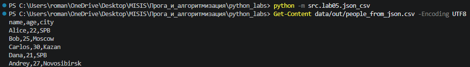
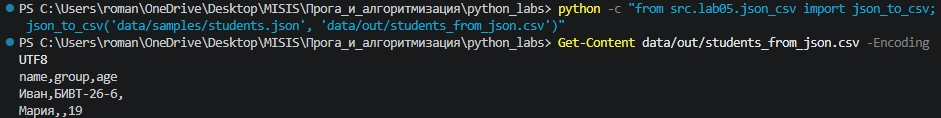
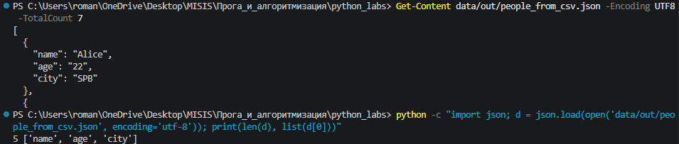
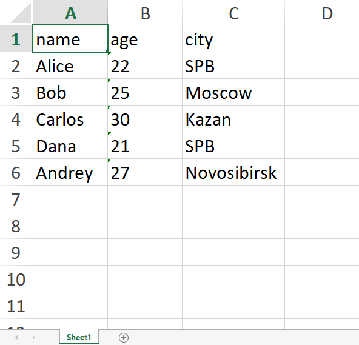
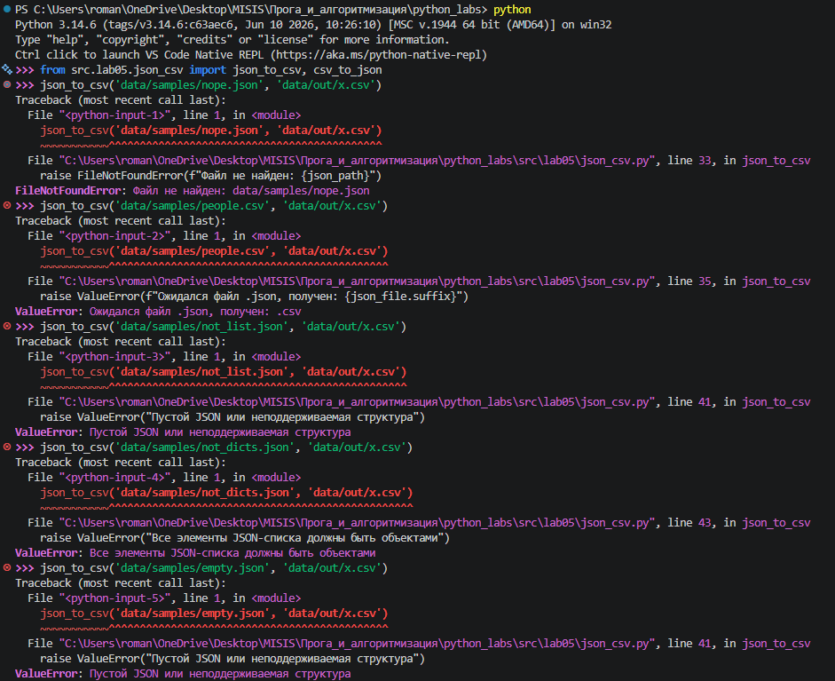
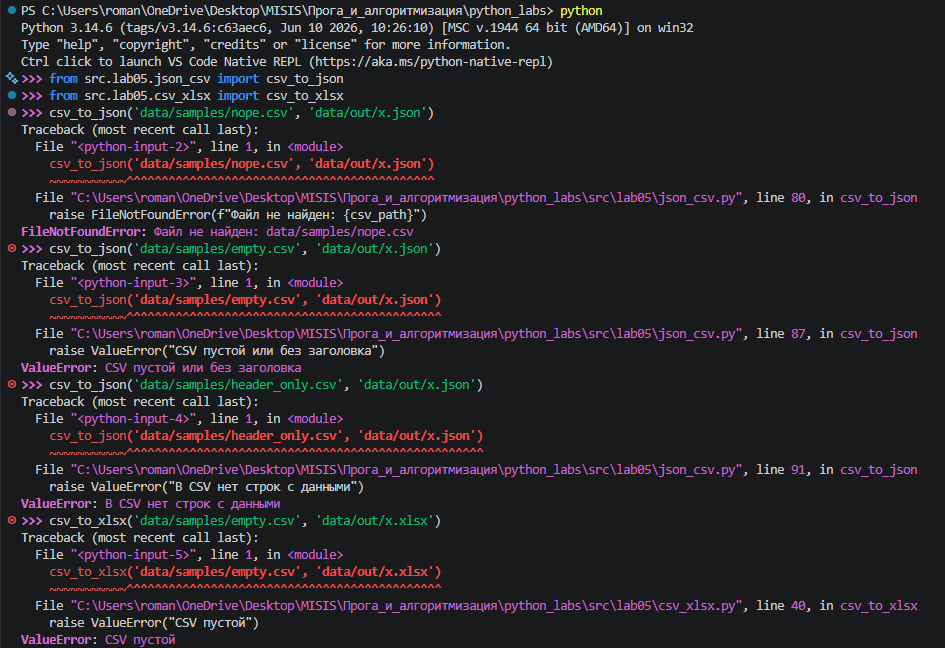

## ЛР5 — JSON и конвертации (JSON↔CSV, CSV→XLSX)

Конвертация между JSON, CSV и XLSX. Задание A использует только стандартную библиотеку (`json`, `csv`, `pathlib`), задание B — дополнительно `openpyxl` (единственная зависимость, см. [`requirements.txt`](../../requirements.txt)).

| № | Задание | Файл | Функции |
|---|---------|------|---------|
| A | JSON ↔ CSV | [`json_csv.py`](json_csv.py) | `json_to_csv`, `csv_to_json` |
| B | CSV → XLSX | [`csv_xlsx.py`](csv_xlsx.py) | `csv_to_xlsx` |

Функции только читают и пишут файлы: ничего не печатают и не перехватывают ошибки, а выбрасывают их вызывающему коду.

### Запуск

Все команды выполняются **из корня репозитория**: пути к файлам относительные и считаются от текущей папки.

```bash
pip install -r requirements.txt

# A: people.json → people_from_json.csv и people.csv → people_from_csv.json
python -m src.lab05.json_csv

# B: people.csv → people.xlsx
python -m src.lab05.csv_xlsx

# свои пути — вызов функции напрямую
python -c "from src.lab05.json_csv import json_to_csv; json_to_csv('data/samples/students.json', 'data/out/students_from_json.csv')"
```

`-m` ищет модуль `src.lab05.json_csv` по `sys.path` и запускает его как `__main__`. При этом `sys.path[0]` — текущая папка (корень), поэтому от корня считаются и импорты, и пути к данным. При запуске `python src/lab05/json_csv.py` в `sys.path[0]` попала бы папка `src/lab05`. Демонстрационные вызовы стоят в блоке `if __name__ == "__main__":` и при импорте модуля не выполняются.

### Форматы

- **JSON** — текст, вложенные структуры из шести типов: объект (`dict`), массив (`list`), строка, число, `true`/`false`, `null`. На входе `json_to_csv` ожидается массив объектов: `[{"name": "Alice", "age": 22}, ...]`.
- **CSV** — текстовая таблица: первая строка — заголовок, разделитель `,`, значения с запятой берутся в кавычки. Типов нет, всё — строки.
- **XLSX** — формат Excel: zip-архив с XML внутри, поэтому пишется через `openpyxl`, а не через `open`.

### Допущения

- **Порядок колонок (JSON → CSV):** ключи первого объекта, затем новые ключи из следующих объектов в порядке появления.
- **Отсутствующие поля** заполняются пустой строкой.
- **Типы не сохраняются:** в CSV нет типов, поэтому после CSV → JSON все значения — строки, а круг JSON → CSV → JSON превращает `22` в `"22"`. Совпадают ключи и количество записей.
- Поддерживаются только **плоские** объекты (без вложенных словарей и списков).
- Предполагается, что в каждой строке CSV столько же значений, сколько колонок в заголовке.
- **XLSX:** лист `Sheet1`, ширина колонки — длина самого длинного значения, минимум 8. Значения переносятся как текст.
- Кодировка всех файлов — UTF-8.

### Тестовые данные

Входные файлы — в [`data/samples/`](../../data/samples), результаты — в [`data/out/`](../../data/out).

| Файл | Для чего |
|------|----------|
| `people.json`, `people.csv`, `cities.csv` | данные из задания |
| `students.json` | объекты с разными ключами, кириллица → объединение колонок и пустые ячейки |
| `students.csv` | значение с запятой в кавычках, кириллица |
| `not_list.json` | объект вместо списка → `ValueError` |
| `not_dicts.json` | `[1, 2, 3]` → `ValueError` |
| `empty.json` | `[]` → `ValueError` |
| `empty.csv` | пустой файл → `ValueError` |
| `header_only.csv` | заголовок без данных → `ValueError` |

### Сценарий 1 — JSON → CSV

`people.json` (5 объектов) → `people_from_json.csv`: заголовок `name,age,city`, 5 строк данных.



`students.json`: у Ивана нет `age`, у Марии нет `group` — колонки объединены, пропуски пустые.



### Сценарий 2 — CSV → JSON

`people.csv` (5 строк) → `people_from_csv.json`: 5 объектов с ключами `name`, `age`, `city`, все значения — строки.



### Сценарий 3 — CSV → XLSX

`people.csv` → `people.xlsx`: лист `Sheet1`, ширина колонок подобрана по содержимому.



### Обработка ошибок

| Вызов | Исключение |
|-------|------------|
| несуществующий файл | `FileNotFoundError: Файл не найден: ...` |
| `json_to_csv` с файлом `.csv` | `ValueError: Ожидался файл .json, получен: .csv` |
| `not_list.json`, `empty.json` | `ValueError: Пустой JSON или неподдерживаемая структура` |
| `not_dicts.json` | `ValueError: Все элементы JSON-списка должны быть объектами` |
| `empty.csv` (`csv_to_json`) | `ValueError: CSV пустой или без заголовка` |
| `header_only.csv` | `ValueError: В CSV нет строк с данными` |
| `empty.csv` (`csv_to_xlsx`) | `ValueError: CSV пустой` |

Синтаксически битый JSON отдельно не проверяется: `json.load` сам выбрасывает `json.JSONDecodeError`, а это подкласс `ValueError`.




