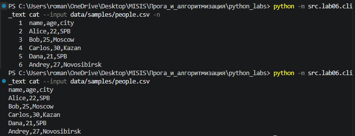
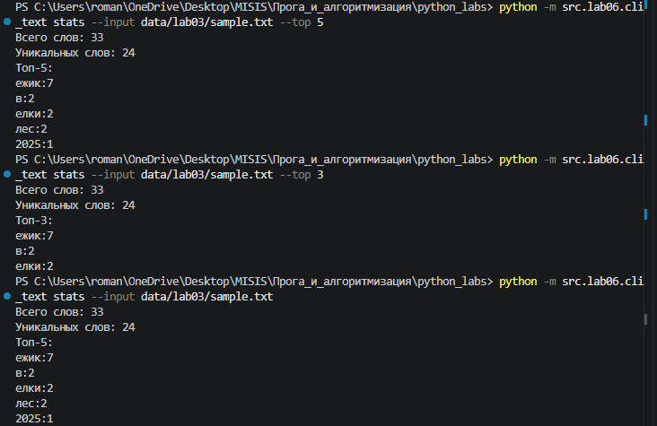
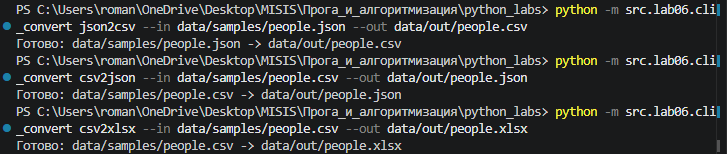
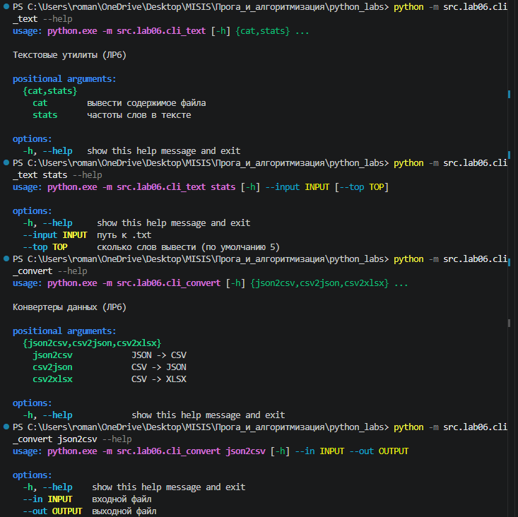
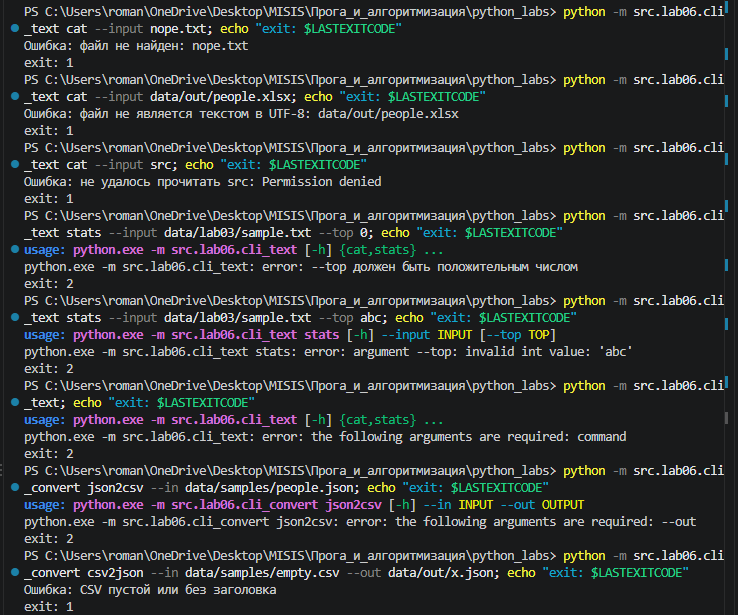

## ЛР6 — CLI-утилиты на argparse

Консольные обёртки над функциями из прошлых лабораторных: анализ текста из ЛР3 (`src/lib/text.py`) и конвертеры из ЛР5 (`src/lab05`). Аргументы разбираются модулем `argparse` из стандартной библиотеки.

| Файл | Подкоманды |
|------|------------|
| [`cli_text.py`](cli_text.py) | `cat`, `stats` |
| [`cli_convert.py`](cli_convert.py) | `json2csv`, `csv2json`, `csv2xlsx` |

### Запуск

Все команды выполняются **из корня репозитория** через `python -m`: тогда `sys.path[0]` — корень, и работают импорты вида `from src.lab05.json_csv import ...`.

```bash
pip install -r requirements.txt   # openpyxl нужен для csv2xlsx (функция из ЛР5)
```

### Подкоманды

**`cli_text.py`**

| Подкоманда | Параметры | Что делает |
|------------|-----------|------------|
| `cat` | `--input <путь>` (обязательный), `-n` (флаг) | выводит файл построчно, с `-n` — с номерами строк |
| `stats` | `--input <путь>` (обязательный), `--top <N>` (по умолчанию 5) | число слов, число уникальных слов и топ-N по частоте |

**`cli_convert.py`**

| Подкоманда | Параметры | Что делает |
|------------|-----------|------------|
| `json2csv` | `--in <путь>`, `--out <путь>` (оба обязательные) | JSON (список объектов) → CSV |
| `csv2json` | `--in <путь>`, `--out <путь>` | CSV с заголовком → JSON |
| `csv2xlsx` | `--in <путь>`, `--out <путь>` | CSV → XLSX |

`--in` хранится в `args.input` (`dest="input"`), потому что `in` — ключевое слово Python и `args.in` не написать.

### Сценарий 1 — cat с нумерацией

```bash
python -m src.lab06.cli_text cat --input data/samples/people.csv -n
```

```text
   1  name,age,city
   2  Alice,22,SPB
   3  Bob,25,Moscow
   4  Carlos,30,Kazan
   5  Dana,21,SPB
   6  Andrey,27,Novosibirsk
```



### Сценарий 2 — stats

```bash
python -m src.lab06.cli_text stats --input data/lab03/sample.txt --top 5
```

```text
Всего слов: 33
Уникальных слов: 24
Топ-5:
ежик:7
в:2
елки:2
лес:2
2025:1
```



### Сценарий 3 — конвертации

```bash
python -m src.lab06.cli_convert json2csv --in data/samples/people.json --out data/out/people.csv
python -m src.lab06.cli_convert csv2json --in data/samples/people.csv --out data/out/people.json
python -m src.lab06.cli_convert csv2xlsx --in data/samples/people.csv --out data/out/people.xlsx
```

Каждая команда печатает `Готово: <вход> -> <выход>`, результаты лежат в [`data/out/`](../../data/out).



### Сценарий 4 — справка

```bash
python -m src.lab06.cli_text --help
python -m src.lab06.cli_text stats --help
python -m src.lab06.cli_convert json2csv --help
```

```text
usage: cli_text.py stats [-h] --input INPUT [--top TOP]

options:
  -h, --help     show this help message and exit
  --input INPUT  путь к .txt
  --top TOP      сколько слов вывести (по умолчанию 5)
```



### Сценарий 5 — ошибки

| Команда | Результат | Код выхода |
|---------|-----------|------------|
| `cli_text cat --input nope.txt` | `Ошибка: файл не найден: nope.txt` | 1 |
| `cli_text cat --input data/out/people.xlsx` | `Ошибка: файл не является текстом в UTF-8: ...` (XLSX — бинарный zip-архив) | 1 |
| `cli_text stats --input data/lab04/input_cp1251.txt` | `Ошибка: файл не является текстом в UTF-8: ...` | 1 |
| `cli_text cat --input src` | `Ошибка: не удалось прочитать src: ...` (папка, а не файл) | 1 |
| `cli_text stats --input x --top 0` | `error: --top должен быть положительным числом` (`parser.error`) | 2 |
| `cli_text stats --input x --top abc` | `error: argument --top: invalid int value: 'abc'` | 2 |
| `cli_text` (без подкоманды) | `error: the following arguments are required: command` | 2 |
| `cli_convert json2csv --in data/samples/people.json` | `error: the following arguments are required: --out` | 2 |
| `cli_convert csv2json --in data/samples/empty.csv --out x.json` | `Ошибка: CSV пустой или без заголовка` | 1 |

Код 2 — ошибка в аргументах, её выдаёт сам `argparse` или `parser.error()`. Код 1 — аргументы верные, но не получилось выполнить работу (нет файла, файл не текстовый, плохие данные): `FileNotFoundError`, `UnicodeDecodeError`, `ValueError` и `OSError` перехватываются и печатаются в `stderr` без трейсбека. `FileNotFoundError` — подкласс `OSError`, поэтому его ветка `except` стоит выше общей.

Любой текстовый файл в UTF-8 (`.py`, `.md`, `.csv`) `cat` и `stats` читают без ошибок: расширение для `open()` значения не имеет.


