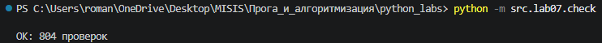
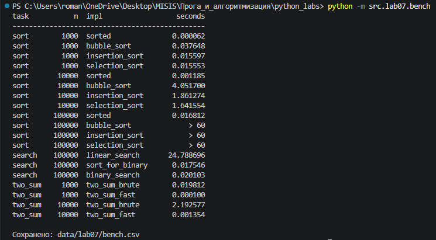

## ЛР7 — Поиск, сортировка и измерение времени

Свои реализации поиска и сортировок, проверка против эталона на случайных данных и замеры времени через `timeit`. Таблица бенчмарка пишется в CSV функцией `write_csv` из ЛР4.

| Файл | Что внутри |
|------|------------|
| [`search.py`](search.py) | `linear_search`, `binary_search`, `two_sum_brute`, `two_sum_fast` |
| [`sorting.py`](sorting.py) | `bubble_sort` (с ранним выходом), `insertion_sort`, `selection_sort` |
| [`check.py`](check.py) | `check_sorting`, `check_search`, `check_two_sum` — сравнение с эталоном |
| [`bench.py`](bench.py) | замеры через `timeit`, таблица в консоль и в [`data/lab07/bench.csv`](../../data/lab07/bench.csv) |

### Запуск

Из корня репозитория:

```bash
python -m src.lab07.check    # проверка против эталона
python -m src.lab07.bench    # бенчмарк (~30 с)
python -m doctest src/lab07/search.py src/lab07/sorting.py -v   # примеры из docstring
```

### Сложность

| Алгоритм | Шагов | Почему |
|----------|-------|--------|
| `linear_search` | O(n) | в худшем случае просматривает весь список |
| `binary_search` | O(log n) | каждый шаг отбрасывает половину отрезка `[lo, hi]` |
| `bubble_sort`, `insertion_sort`, `selection_sort` | O(n²) | два вложенных цикла по списку |
| `sorted` (Timsort) | O(n log n) | слияние отсортированных кусков, написан на C |
| `two_sum_brute` | O(n²) | перебор всех пар `i < j` |
| `two_sum_fast` | O(n) | один проход, проверка `in` у словаря — в среднем O(1) |

Пузырёк и вставки на уже отсортированном списке работают за O(n): у пузырька срабатывает флаг «обменов не было», у вставок внутренний `while` не делает ни одного сдвига. Выбор всегда O(n²): минимум ищется по всей оставшейся части.

### Сценарий 1 — проверка против эталона

```bash
python -m src.lab07.check
```

```text
OK: 804 проверок
```



Из чего складываются 804 проверки (`random.seed(42)`):

| Функция | Что сравнивается | Проверок |
|---------|------------------|----------|
| `check_sorting` × 3 сортировки | `fn(nums) == sorted(nums)` и исходный список не изменён; 100 случайных списков длиной 0–50, значения от −100 до 100, + `[]` и `[7]` | 3 × 102 = 306 |
| `check_search` | `linear_search` против `list.index` (`ValueError` ↔ `-1`); `binary_search` на отсортированных: найденный индекс указывает на `x` или `-1`, если `x` нет; отдельно первый и последний элементы | 398 |
| `check_two_sum` | оба способа дают корректную пару (`i < j`, сумма равна `target`) или оба `None` | 100 |

`binary_search` и `two_sum_fast` при повторах могут вернуть не тот индекс, что эталон, и это не ошибка: по условию допустим любой. Поэтому для них проверяется **свойство ответа** (по индексу лежит `x`, сумма пары равна `target`), а не равенство с эталоном.

### Сценарий 2 — бенчмарк

```bash
python -m src.lab07.bench
```

```text
task           n  impl                  seconds
-----------------------------------------------
sort        1000  sorted               0.000062
sort        1000  bubble_sort          0.037648
sort        1000  insertion_sort       0.015597
sort        1000  selection_sort       0.015553
sort       10000  sorted               0.001185
sort       10000  bubble_sort          4.051700
sort       10000  insertion_sort       1.861274
sort       10000  selection_sort       1.641554
sort      100000  sorted               0.016812
sort      100000  bubble_sort              > 60
sort      100000  insertion_sort           > 60
sort      100000  selection_sort           > 60
search    100000  linear_search       24.788696
search    100000  sort_for_binary      0.017546
search    100000  binary_search        0.020103
two_sum     1000  two_sum_brute        0.019812
two_sum     1000  two_sum_fast         0.000100
two_sum    10000  two_sum_brute        2.192577
two_sum    10000  two_sum_fast         0.001354
```



Как устроены замеры:

- `random.seed(42)` в начале, данные генерируются **один раз** на каждый `n`, и все алгоритмы получают один и тот же список. Сортировки не портят его, потому что возвращают копию.
- **Повторы и минимум** (правила замера из Л8). Быстрые операции (`sorted`, бинарный поиск, `two_sum_fast`, квадратичные сортировки на n = 1 000) — `timeit.repeat`: 5 серий по 10 запусков, берётся лучшая серия и делится на 10. Минимум, а не среднее: всё, что больше минимума, — помехи системы (другие процессы, сборщик мусора), а не сам алгоритм. Медленные операции (квадратичные сортировки на 10 000, линейный поиск, `two_sum_brute` на 10 000) идут секунды — их запускаем один раз: помехи в миллисекунды на такой результат не влияют, а повторы растянули бы бенчмарк на минуты. За это отвечает параметр `slow` у функции `measure` и константа `ONE_RUN_FROM`.
- Квадратичные сортировки на n = 100 000 не запускаются (`SKIP_ABOVE = 10_000`). Оценка: при росте n в 10 раз время растёт в ~100 раз, значит пузырёк займёт около 4 с × 100 ≈ 400 с, вставки и выбор — 160–190 с. Это больше 60 с, поэтому в таблице `> 60`.
- Поиск: список из 100 000 чисел от 0 до 200 000 и 10 000 случайных запросов. Примерно 40 % запросов в списке есть, остальные заставляют линейный поиск пройти весь список. Сортировка для бинарного поиска — отдельной строкой `sort_for_binary`.
- Two Sum: `n − 2` случайных числа до 10⁶ и два больших в конце (`10 000 000` и `10 000 001`). Ответ существует, единственный и стоит в самом конце, поэтому перебор проходит все пары. В первой версии `target` был суммой двух последних случайных чисел, и при n = 10 000 у перебора было 0,08 с: таких пар в списке десятки, и одна находилась почти сразу. Замер был нечестным.
- В первой версии всё мерилось одним запуском (`number=1`). Для `sorted` на n = 1 000 это доли миллисекунды, и отношения прыгали от прогона к прогону (×9 и ×20). С минимумом из повторов они стабильны: ×19 и ×14 в итоговом прогоне, близкие значения и в повторных.

Те же данные — в [`data/lab07/bench.csv`](../../data/lab07/bench.csv) (колонки `task,n,impl,seconds`, одна строка — один замер).

### Выводы

**Почему пузырёк при росте n в 10 раз замедляется в ~100 раз, а `sorted` — примерно в 12.** Пузырёк делает порядка n²/2 сравнений. При n × 10 сравнений становится в 10² = 100 раз больше, и замер это подтверждает: 0,038 с → 4,05 с, в ~108 раз. Вставки растут в ~119 раз, выбор — в ~106. Небольшое превышение ×100 ожидаемо: время на n = 1 000 взято минимумом из повторов, а на 10 000 — одним запуском, большой список хуже помещается в кэш процессора, а O(n²) говорит о порядке роста, а не о точном множителе. Порядок у всех трёх один — ×100, а не ×10 и не ×1000. У `sorted` (Timsort) O(n log n): множитель равен 10 · log(10n) / log n. Для 10³ → 10⁴ это 10 · 13,3 / 10 ≈ 13, для 10⁴ → 10⁵ — 10 · 16,6 / 13,3 ≈ 12,5. Замер дал ×19 и ×14. Второй переход близок к теории. Первый заметно выше: вероятная причина та же — 1 000 чисел целиком в кэше, а с ростом списка обращения к памяти дорожают. В лекции 9 у `sorted` тоже вышло чуть больше теории: ×13,7 и ×15,6. Кроме того, `sorted` написан на C, поэтому уже на n = 1 000 он в ~600 раз быстрее пузырька: дело не только в асимптотике, но и в цене одного шага.

**Почему бинарный поиск бесполезен без сортировки и когда она окупается.** Бинарный поиск полагается на то, что слева от середины всё меньше, а справа всё больше. На неотсортированном списке это не так: он отбросит половину, в которой лежит `x`, и вернёт `-1` или случайный индекс. Сортировка стоит O(n log n), а один линейный поиск — O(n), поэтому ради одного запроса сортировать невыгодно. Для многих запросов картина обратная. По замеру один линейный поиск стоит 24,8 с / 10 000 ≈ 2,5 мс, бинарный ≈ 2 мкс, сортировка 17,5 мс. Сортировка окупается, если запросов больше 17,5 мс / 2,5 мс ≈ **7**. На 10 000 запросах линейный поиск занял 24,8 с, а сортировка вместе с бинарным поиском — 0,038 с, примерно в 650 раз быстрее.

**Что показал `check.py`.** 804 проверки на случайных данных (`seed = 42`), расхождений в итоговой версии нет. Чтобы убедиться, что проверка вообще умеет находить ошибки, я специально ломал функции во временной копии. Если в цикле `while` сортировки вставками написать `j > 0` вместо `j >= 0`, проверка падает на первом же списке: `insertion_sort ошиблась на [45, 95, -84, -35, -70, 26, 94, 15]: [45, -84, -70, ...]` — первый элемент никогда не сдвигается. Если в бинарном поиске написать `lo = mid` вместо `lo = mid + 1`, на списке `[1, 3]` и `x = 3` получается бесконечный цикл: `lo = 0`, `hi = 1`, `mid = 0`, и `lo` не двигается. Поэтому границы `lo`, `hi` и условие `while lo <= hi` проверяются на пустом списке, списке из одного элемента, на крайних элементах и на `x`, которого нет. Ещё один вывод из `check.py`: при повторах `binary_search` и `two_sum_fast` правильно сравнивать не с ответом эталона, а с условием задачи, иначе проверка «найдёт» ошибку там, где её нет.
