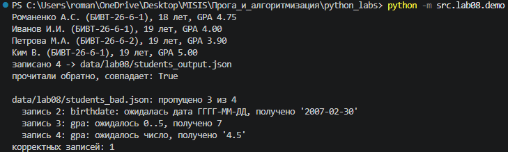

## ЛР8 — Модель данных без классов: запись `Student` как словарь

Модель студента — словарь с фиксированным набором ключей. Функции создают и проверяют записи, а список записей сохраняется в JSON и читается обратно. Классов нет: только словари и функции.

| Файл | Что внутри |
|------|------------|
| [`models.py`](models.py) | `STUDENT_FIELDS`, `make_student`, `validate_student`, `student_age`, `format_student`, `student_to_dict`, `student_from_dict` |
| [`serialize.py`](serialize.py) | `students_to_json`, `students_from_json` |
| [`demo.py`](demo.py) | запуск на файлах из `data/lab08` |
| [`data/lab08/`](../../data/lab08/) | `students_input.json`, `students_output.json`, `students_bad.json` |

### Запуск

Из корня репозитория:

Чтение, запись и битые записи:

```bash
python -m src.lab08.demo
```

Примеры из docstring:

```bash
python -m doctest src/lab08/models.py -v
```

### Задание A — модель `Student` (`models.py`)

Запись — словарь ровно с ключами `STUDENT_FIELDS = ("fio", "birthdate", "group", "gpa")`:

```python
{"fio": "Иванов Иван Иванович", "birthdate": "2007-05-14", "group": "БИВТ-26-6-1", "gpa": 4.3}
```

| Поле | Тип | Правило |
|------|-----|---------|
| `fio` | `str` | непустая после `strip()` |
| `birthdate` | `str` | строго `ГГГГ-ММ-ДД`, такая дата есть, не в будущем |
| `group` | `str` | непустая после `strip()` |
| `gpa` | `float` | от 0 до 5; `int` принимается и приводится к `float`, `bool` и строка — нет |

| Функция | Что делает |
|---------|------------|
| `make_student` | собирает словарь, проверяет его `validate_student`, приводит `gpa` к `float` |
| `validate_student` | проверяет набор ключей, потом каждое значение; ничего не возвращает |
| `student_age` | полных лет на `today`: разность годов минус 1, если день рождения в этом году ещё не наступил |
| `format_student` | `Иванов И.И. (БИВТ-26-6-1), 19 лет, GPA 4.30`; инициалы — как в ЛР1 |
| `student_to_dict` | проверяет запись и возвращает её копию (новый словарь) |
| `student_from_dict` | берёт из словаря ключи `STUDENT_FIELDS` (лишние отбрасывает, пропуск — ошибка) и отдаёт в `make_student` |

Ошибки по правилу из Л10: не тот тип — `TypeError`, не то значение — `ValueError`. В сообщении поле, что ждали, что получили: `gpa: ожидалось 0..5, получено 7`.

Дата проверяется в два шага. `date.fromisoformat` отсекает несуществующие даты (`2007-02-30`), но принимает и `20070514`. Поэтому дополнительно `born.isoformat() == birthdate`: проходит только вид `ГГГГ-ММ-ДД`.

```python
"""ЛР8, задание A: модель Student — запись-словарь без классов.

Запись — словарь ровно с ключами STUDENT_FIELDS:
    fio        str    ФИО, непустая строка
    birthdate  str    дата рождения ГГГГ-ММ-ДД, существует, не в будущем
    group      str    группа, непустая строка
    gpa        float  средний балл от 0 до 5

Записи создаются через make_student или student_from_dict: обе
проверяют данные. Не тот тип — TypeError, не то значение — ValueError;
в сообщении поле, что ждали и что получили.
"""

from datetime import date

STUDENT_FIELDS = ("fio", "birthdate", "group", "gpa")


def make_student(fio, birthdate, group, gpa) -> dict:
    """Собирает запись студента и проверяет каждое поле.

    Args:
        fio: ФИО, например "Иванов Иван Иванович".
        birthdate: дата рождения строкой ГГГГ-ММ-ДД.
        group: группа, например "БИВТ-26-6-1".
        gpa: средний балл, int или float от 0 до 5.

    Returns:
        Запись-словарь; gpa в ней всегда float.

    Raises:
        TypeError, ValueError: поле не прошло проверку (см. validate_student).

    >>> make_student("Иванов Иван Иванович", "2007-05-14", "БИВТ-26-6-1", 4)
    {'fio': 'Иванов Иван Иванович', 'birthdate': '2007-05-14', 'group': 'БИВТ-26-6-1', 'gpa': 4.0}
    """
    rec = {"fio": fio, "birthdate": birthdate, "group": group, "gpa": gpa}
    validate_student(rec)
    rec["gpa"] = float(gpa)
    return rec


def validate_student(rec: dict) -> None:
    """Проверяет запись: набор ключей и значение каждого поля.

    Дата проверяется в два шага: date.fromisoformat отсекает
    несуществующие дни, а сравнение born.isoformat() == birthdate —
    другие формы записи вроде "20070514", которые fromisoformat
    тоже принимает.

    Raises:
        TypeError: rec не словарь или у поля не тот тип.
        ValueError: нет нужного ключа, есть лишний или значение
            не подходит (пустая строка, нет такой даты, gpa вне 0..5).

    >>> validate_student({"fio": "Иванов Иван", "birthdate": "2007-02-30",
    ...                   "group": "БИВТ-26-6-1", "gpa": 4.3})
    Traceback (most recent call last):
    ...
    ValueError: birthdate: ожидалась дата ГГГГ-ММ-ДД, получено '2007-02-30'
    >>> validate_student({"fio": "Иванов Иван", "birthdate": "2007-05-14",
    ...                   "group": "БИВТ-26-6-1", "gpa": 7})
    Traceback (most recent call last):
    ...
    ValueError: gpa: ожидалось 0..5, получено 7
    >>> validate_student({"fio": "Иванов Иван", "birthdate": "2007-05-14",
    ...                   "group": "БИВТ-26-6-1", "gpa": True})
    Traceback (most recent call last):
    ...
    TypeError: gpa: ожидалось число, получено True
    """
    if type(rec) is not dict:
        raise TypeError(f"ожидался словарь, получено {rec!r}")
    for key in STUDENT_FIELDS:
        if key not in rec:
            raise ValueError(f"нет поля {key!r}")
    for key in rec:
        if key not in STUDENT_FIELDS:
            raise ValueError(f"лишнее поле {key!r}")

    for key in ("fio", "group"):
        value = rec[key]
        if type(value) is not str:
            raise TypeError(f"{key}: ожидалась строка, получено {value!r}")
        if not value.strip():
            raise ValueError(f"{key}: ожидалась непустая строка, получено {value!r}")

    birthdate = rec["birthdate"]
    if type(birthdate) is not str:
        raise TypeError(f"birthdate: ожидалась строка, получено {birthdate!r}")
    try:
        born = date.fromisoformat(birthdate)
    except ValueError:
        raise ValueError(
            f"birthdate: ожидалась дата ГГГГ-ММ-ДД, получено {birthdate!r}"
        ) from None
    if born.isoformat() != birthdate:
        raise ValueError(
            f"birthdate: ожидалась дата ГГГГ-ММ-ДД, получено {birthdate!r}"
        )
    if born > date.today():
        raise ValueError(f"birthdate: дата в будущем: {birthdate!r}")

    gpa = rec["gpa"]
    if type(gpa) not in (int, float):
        raise TypeError(f"gpa: ожидалось число, получено {gpa!r}")
    if not 0 <= gpa <= 5:
        raise ValueError(f"gpa: ожидалось 0..5, получено {gpa!r}")


def student_age(rec: dict, today: date | None = None) -> int:
    """Считает полных лет на дату today (по умолчанию — сегодня).

    Разность годов минус 1, если в году today день рождения
    ещё не наступил.

    >>> s = make_student("Петров Пётр", "2007-09-20", "БИВТ-26-6-1", 4.0)
    >>> student_age(s, today=date(2026, 9, 19))
    18
    >>> student_age(s, today=date(2026, 9, 20))
    19
    """
    if today is None:
        today = date.today()
    elif type(today) is not date:
        raise TypeError(f"today: ожидалась дата (date), получено {today!r}")
    born = date.fromisoformat(rec["birthdate"])
    age = today.year - born.year
    if (today.month, today.day) < (born.month, born.day):
        age -= 1
    return age


def _years_word(n: int) -> str:
    """Слово после числа: 1 год, 3 года, 11 лет, 21 год."""
    if n % 10 == 1 and n % 100 != 11:
        return "год"
    if 2 <= n % 10 <= 4 and not 12 <= n % 100 <= 14:
        return "года"
    return "лет"


def format_student(rec: dict) -> str:
    """Строка вида 'Иванов И.И. (БИВТ-26-6-1), 19 лет, GPA 4.30'.

    Инициалы — первые буквы всех слов ФИО, кроме первого (как в ЛР1).
    Возраст считается на сегодня.
    """
    parts = rec["fio"].split()
    initials = "".join(word[0] + "." for word in parts[1:])
    name = f"{parts[0]} {initials}".rstrip()
    age = student_age(rec)
    return f"{name} ({rec['group']}), {age} {_years_word(age)}, GPA {rec['gpa']:.2f}"


def student_to_dict(rec: dict) -> dict:
    """Проверяет запись и возвращает её копию для сериализации.

    Копия — новый словарь: изменения в нём не затрагивают rec.

    >>> s = make_student("Иванов Иван", "2007-05-14", "БИВТ-26-6-1", 4.3)
    >>> d = student_to_dict(s)
    >>> d == s, d is s
    (True, False)
    """
    validate_student(rec)
    return dict(rec)


def student_from_dict(d: dict) -> dict:
    """Делает запись из словаря, прочитанного из JSON.

    Берёт из d только ключи STUDENT_FIELDS: лишние отбрасываются,
    отсутствующий — ошибка. Дальше — make_student: проверка и gpa -> float.

    >>> student_from_dict({"gpa": 5, "group": "БИВТ-26-6-1", "fio": "Иванов Иван",
    ...                    "birthdate": "2007-05-14", "email": "i@misis.ru"})
    {'fio': 'Иванов Иван', 'birthdate': '2007-05-14', 'group': 'БИВТ-26-6-1', 'gpa': 5.0}
    """
    if type(d) is not dict:
        raise TypeError(f"ожидался объект JSON, получено {d!r}")
    for key in STUDENT_FIELDS:
        if key not in d:
            raise ValueError(f"нет поля {key!r}")
    return make_student(d["fio"], d["birthdate"], d["group"], d["gpa"])
```

### Задание B — сериализация (`serialize.py`)

- `students_to_json(students, path)` — каждая запись через `student_to_dict`, затем `json.dump(..., ensure_ascii=False, indent=2)`. Записи проверяются до открытия файла, поэтому битая запись не затрёт старый файл.
- `students_from_json(path)` — `json.load`, проверка, что это массив, затем `student_from_dict` для каждого элемента.

#### Политика обработки битых записей — `skip`

Битая запись пропускается, функция возвращает корректные. В конце в консоль выводится, сколько записей пропущено, и для каждой — номер (с 1) и причина.

Почему `skip`, а не `strict`: в файле может быть несколько ошибок, и `strict` показывает их по одной за запуск. `skip` показывает все сразу (Л10: «файл — все ошибки с номерами строк, потом отчёт»). Записи не теряются молча: про каждую пропущенную выводится причина.

```python
"""ЛР8, задание B: сохранение и загрузка списка студентов в JSON.

JSON — массив объектов с ключами STUDENT_FIELDS, ensure_ascii=False,
indent=2. Каждая прочитанная запись проходит student_from_dict.

Политика для битых записей — skip: битая запись пропускается,
в конце в консоль выводится, сколько записей пропущено и почему
(номер записи с 1 и причина). Так в файле видны все ошибки за один
запуск, а не по одной.
"""

import json
from pathlib import Path

from src.lab08.models import student_from_dict, student_to_dict


def students_to_json(students: list[dict], path: str) -> None:
    """Сохраняет список записей в JSON-файл.

    Все записи проверяются и копируются (student_to_dict) до открытия
    файла: если какая-то битая, старый файл не затрётся. Папка
    создаётся, если её нет.
    """
    data = [student_to_dict(s) for s in students]
    out = Path(path)
    out.parent.mkdir(parents=True, exist_ok=True)
    with out.open("w", encoding="utf-8") as f:
        json.dump(data, f, ensure_ascii=False, indent=2)


def students_from_json(path: str) -> list[dict]:
    """Читает записи из JSON-файла, битые пропускает (политика skip).

    Returns:
        Список корректных записей.

    Raises:
        FileNotFoundError: файла нет.
        json.JSONDecodeError: файл — не JSON (подкласс ValueError).
        TypeError: в файле не массив.
    """
    with open(path, encoding="utf-8") as f:
        data = json.load(f)
    if type(data) is not list:
        raise TypeError(f"{path}: ожидался JSON-массив, получено {type(data).__name__}")

    students = []
    errors = []
    for number, item in enumerate(data, start=1):
        try:
            students.append(student_from_dict(item))
        except (TypeError, ValueError) as e:
            errors.append(f"запись {number}: {e}")

    if errors:
        print(f"{path}: пропущено {len(errors)} из {len(data)}")
        for line in errors:
            print(f"  {line}")
    return students
```

### Сценарий 1 — JSON туда-обратно и битые записи

```bash
python -m src.lab08.demo
```

```text
Романенко А.С. (БИВТ-26-6-1), 18 лет, GPA 4.75
Иванов И.И. (БИВТ-26-6-1), 19 лет, GPA 4.00
Петрова М.А. (БИВТ-26-6-2), 19 лет, GPA 3.90
Ким В. (БИВТ-26-6-1), 19 лет, GPA 5.00
записано 4 -> data/lab08/students_output.json
прочитали обратно, совпадает: True

data/lab08/students_bad.json: пропущено 3 из 4
  запись 2: birthdate: ожидалась дата ГГГГ-ММ-ДД, получено '2007-02-30'
  запись 3: gpa: ожидалось 0..5, получено 7
  запись 4: gpa: ожидалось число, получено '4.5'
корректных записей: 1
```



`demo.py`:

```python
"""ЛР8: запуск модели и сериализации на файлах из data/lab08.

Запуск из корня репозитория:
    python -m src.lab08.demo
"""

from src.lab08.models import format_student
from src.lab08.serialize import students_from_json, students_to_json

INPUT_JSON = "data/lab08/students_input.json"
OUTPUT_JSON = "data/lab08/students_output.json"
BAD_JSON = "data/lab08/students_bad.json"


def main() -> None:
    students = students_from_json(INPUT_JSON)
    for s in students:
        print(format_student(s))
    students_to_json(students, OUTPUT_JSON)
    print(f"записано {len(students)} -> {OUTPUT_JSON}")
    print("прочитали обратно, совпадает:", students_from_json(OUTPUT_JSON) == students)

    print()
    good = students_from_json(BAD_JSON)
    print(f"корректных записей: {len(good)}")


if __name__ == "__main__":
    main()
```

### Сценарий 2 — JSON до и после преобразования

**До** (`students_input.json`, записи 2 и 3):

```json
{
  "fio": "Иванов Иван Иванович",
  "birthdate": "2007-05-14",
  "group": "БИВТ-26-6-1",
  "gpa": 4
},
{
  "gpa": 3.9,
  "group": "БИВТ-26-6-2",
  "birthdate": "2007-09-20",
  "fio": "Петрова Мария Андреевна",
  "email": "petrova@edu.misis.ru"
}
```

**После** (`students_output.json`):

```json
{
  "fio": "Иванов Иван Иванович",
  "birthdate": "2007-05-14",
  "group": "БИВТ-26-6-1",
  "gpa": 4.0
},
{
  "fio": "Петрова Мария Андреевна",
  "birthdate": "2007-09-20",
  "group": "БИВТ-26-6-2",
  "gpa": 3.9
}
```

- `gpa: 4` стал `4.0` — `make_student` приводит его к `float`;
- ключи встали в порядке `STUDENT_FIELDS` — `make_student` собирает словарь в этом порядке;
- `email` пропал — `student_from_dict` берёт только нужные ключи.

Повторное чтение `students_output.json` даёт тот же список (`совпадает: True`): запись и чтение ничего не теряют.

### Сценарий 3 — битые записи

`students_bad.json` — четыре записи:

| № | Что не так | Исключение |
|---|-----------|------------|
| 1 | всё верно | — |
| 2 | `"birthdate": "2007-02-30"` — такого дня нет | `ValueError` |
| 3 | `"gpa": 7` — вне 0..5 | `ValueError` |
| 4 | `"gpa": "4.5"` — строка, а не число | `TypeError` |

Вывод — в сценарии 1: пропущены записи 2–4, у каждой причина, прочитана одна корректная.

### Выводы

- Словарь с фиксированными ключами плюс функция-конструктор дают одно место, где запись создаётся и проверяется. Но словарь не мешает написать `rec["gpa"] = 100` в обход проверки: эту дисциплину держит программист.
- Проверка — на границе, там, где данные входят в программу: при чтении JSON (`student_from_dict`). Внутри, например в `student_age`, данные уже не проверяются.
- `date.fromisoformat` проверяет, что день существует, но формат принимает шире `ГГГГ-ММ-ДД`.
- `student_to_dict` возвращает копию: два имени, указывающие на один словарь, видят изменения друг друга (Л3).
