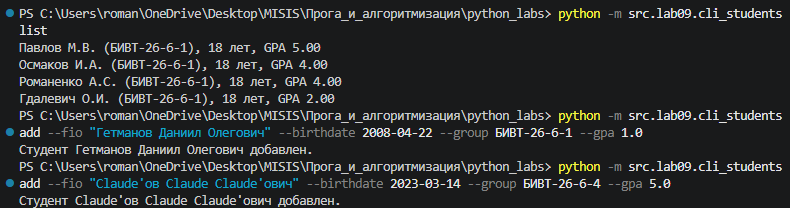
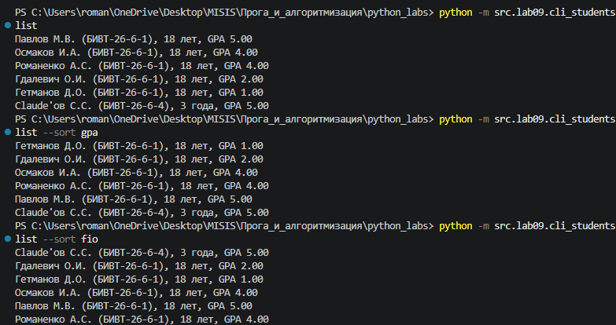
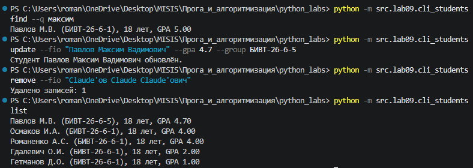
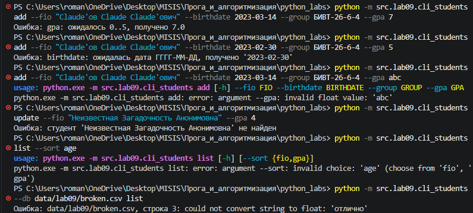

## ЛР9 — «База данных» на CSV: CRUD над `students.csv` и CLI

Хранилище студентов — обычный CSV-файл. Над ним работает набор функций с общим первым аргументом `path`: служебные (создать, прочитать, записать файл) и CRUD (добавить, прочитать, найти, обновить, удалить). Сверху — консольная утилита на `argparse`. Классов нет: «состояние» группы функций — путь к файлу, который передаётся явно.

Используется из прошлых работ: запись `Student` и её проверка (ЛР8), `csv.DictReader`/`DictWriter` (ЛР4–5), подкоманды `argparse` (ЛР6), `sorted` с `key` (ЛР7).

| Файл | Что внутри |
|------|------------|
| [`group.py`](group.py) | `ensure_storage`, `load_students`, `save_students`; CRUD: `add_student`, `list_students`, `find_students`, `remove_student`, `update_student` |
| [`cli_students.py`](cli_students.py) | CLI: подкоманды `add`, `list`, `find`, `remove`, `update`, общий `--db` |
| [`data/lab09/students.csv`](../../data/lab09/students.csv) | хранилище — «база данных» студентов |

### Запуск

Из корня репозитория:

```bash
python -m src.lab09.cli_students --help
python -m src.lab09.cli_students list --sort gpa
```

`--db` — путь к хранилищу, пишется **до** подкоманды; по умолчанию `data/lab09/students.csv`:

```bash
python -m src.lab09.cli_students --db data/lab09/other.csv list
```

### Формат хранилища

```csv
fio,birthdate,group,gpa
Иванов Иван,2007-10-10,БИВТ-26-6-1,4.3
```

Заголовок — ровно `STUDENT_FIELDS` из ЛР8, в том же порядке. Каждая строка — запись `Student`: те же правила, что в ЛР8 (непустые `fio` и `group`, дата `ГГГГ-ММ-ДД` не в будущем, `gpa` от 0 до 5).

### Задание A — хранилище и CRUD (`group.py`)

#### Загрузить → изменить → сохранить

CSV — просто текст: нельзя поменять или удалить одну строку на месте. Поэтому все изменяющие операции устроены одинаково:

```text
students = load_students(path)     # весь файл -> список словарей
...изменить список в памяти...       # append / фильтр / замена элемента
save_students(path, students)      # перезаписать файл целиком
```

Читающие операции (`list`, `find`) только загружают и файл не меняют.

| Функция | Операция | Что делает |
|---------|----------|------------|
| `ensure_storage` | — | нет файла — создаёт его (и папки) с одной строкой-заголовком; есть — не трогает |
| `load_students` | — | `DictReader` + проверка заголовка и каждой строки; первой строкой вызывает `ensure_storage` |
| `save_students` | — | проверяет все записи, затем `DictWriter` перезаписывает файл |
| `add_student` | Create | проверить запись → load → `append` → save |
| `list_students` | Read | все записи; `sort_by` ∈ {`None`, `"fio"`, `"gpa"`} |
| `find_students` | Read | подстрока в `fio` без учёта регистра |
| `update_student` | Update | меняет поля **первой** записи с этим `fio`; `True`/`False` — нашлась ли |
| `remove_student` | Delete | удаляет **все** записи с этим `fio`; возвращает, сколько удалено |

`ensure_storage` вызывается в одном месте — в `load_students`. С неё начинается каждая операция, поэтому все функции работают и на несуществующем файле: первый вызов создаст хранилище с заголовком.

#### Валидация на входе и на выходе

**При чтении** (`load_students`):

- заголовок сравнивается со `list(STUDENT_FIELDS)`: `reader.fieldnames` — список, а `STUDENT_FIELDS` — кортеж, и `['a'] == ('a',)` в Python — `False`. У пустого файла `fieldnames` — `None`;
- `DictReader` **не падает**, если в строке не столько значений, сколько колонок: лишние кладёт в ключ `None`, недостающим полям ставит значение `None`. Поэтому `None in row` и `None in row.values()` проверяются явно;
- из CSV всё приходит строками. `validate_student` из ЛР8 строку `"4.3"` в `gpa` не пропустит (`TypeError`), поэтому `gpa` переводится во `float` **до** `student_from_dict`. ЛР8 не менялась: в JSON число-строка — ошибка данных, а строки — особенность именно CSV;
- ошибки `float` и ЛР8 перехватываются и перебрасываются как `ValueError` с номером строки файла (строка 1 — заголовок, поэтому `enumerate(reader, start=2)`); `from None` убирает из вывода трассировку исходного исключения.

Битая строка — ошибка, а не пропуск (политика `skip` из ЛР8 здесь не подходит): пропущенная при чтении строка пропала бы из файла при следующем `save_students`.

**При записи:**

- `add_student` и `update_student` пропускают запись через `student_from_dict`: проверка плюс `gpa` всегда `float` (в файле `4.0`, а не `4`);
- `save_students` проверяет **все** записи до `open(..., "w")`: режим `"w"` сразу очищает файл, и ошибка на середине записи потеряла бы остальных студентов.

#### Детали CRUD

- `list_students`: неизвестный `sort_by` — `ValueError` до чтения файла. `sorted` стабильный: Осмаков и Романенко с одинаковым `gpa` 4.0 остаются в порядке файла.
- `find_students`: в нижний регистр приводятся **обе** стороны. Если опустить только `fio`, запрос `"Иван"` не найдёт ничего.
- `remove_student`: новый список через фильтр, а не `pop` в цикле — `pop` внутри `for` сдвигает элементы, и цикл перескакивает соседнюю запись (две одинаковые подряд — вторая выживет). Удалять некого — файл не перезаписывается.
- `update_student`: неизвестный ключ — `KeyError` до чтения файла. Обновляется копия записи, проверяется и только потом сохраняется.

```python
"""ЛР9, задание A: «база данных» студентов на CSV — хранилище и CRUD.

Файл хранилища — CSV с заголовком fio,birthdate,group,gpa
(STUDENT_FIELDS из ЛР8), одна строка — один студент.

Классов нет: каждая функция получает путь к CSV первым аргументом.
CSV нельзя поменять построчно на месте, поэтому изменяющие операции
(add, remove, update) устроены одинаково: загрузить весь файл в
список -> изменить список в памяти -> перезаписать файл целиком.
Читающие операции (list, find) файл не меняют.

Каждая строка при чтении проходит student_from_dict из ЛР8, каждая
новая или изменённая запись проверяется до сохранения. Ошибки
данных — ValueError (или TypeError от ЛР8), неизвестное поле
в update_student — KeyError.
"""

import csv
from pathlib import Path

from src.lab08.models import STUDENT_FIELDS, student_from_dict, validate_student


def ensure_storage(path) -> None:
    """Создаёт CSV-хранилище с одним заголовком, если файла ещё нет.

    Существующий файл не трогается: режим "w" стёр бы его. Недостающие
    папки создаются.

    Raises:
        ValueError: по пути лежит не файл (например, папка).
    """
    out = Path(path)
    if out.exists():
        if not out.is_file():
            raise ValueError(f"{path}: путь существует, но это не файл")
        return
    out.parent.mkdir(parents=True, exist_ok=True)
    with out.open("w", encoding="utf-8", newline="") as f:
        writer = csv.DictWriter(f, fieldnames=STUDENT_FIELDS)
        writer.writeheader()


def load_students(path) -> list[dict]:
    """Читает все записи из CSV-хранилища.

    Если файла нет, он создаётся (ensure_storage) и возвращается [].
    Из CSV всё приходит строками, поэтому gpa переводится во float
    до student_from_dict: validate_student из ЛР8 строку не примет.

    DictReader не падает, если в строке не столько значений, сколько
    колонок: лишние кладёт в ключ None, недостающим полям ставит
    значение None. Оба случая проверяются явно.

    Битая строка — ошибка, а не пропуск: иначе следующий save_students
    молча удалил бы её из файла.

    Returns:
        Список записей; gpa в них — float.

    Raises:
        ValueError: нет заголовка или он не fio,birthdate,group,gpa;
            в строке лишние, недостающие или пустые значения; запись
            не прошла проверку ЛР8. В сообщении — номер строки файла.
    """
    ensure_storage(path)
    with open(path, "r", encoding="utf-8", newline="") as f:
        reader = csv.DictReader(f)
        if reader.fieldnames != list(STUDENT_FIELDS):
            got = ",".join(reader.fieldnames) if reader.fieldnames else "пустой файл"
            raise ValueError(
                f"{path}: ожидался заголовок {','.join(STUDENT_FIELDS)}, получено {got}"
            )
        students = []
        for n, row in enumerate(reader, start=2):
            if None in row:
                raise ValueError(f"{path}, строка {n}: лишние значения {row[None]}")
            if None in row.values():
                raise ValueError(f"{path}, строка {n}: не хватает значений")
            if "" in row.values():
                raise ValueError(f"{path}, строка {n}: пустое значение")
            try:
                row["gpa"] = float(row["gpa"])
                student = student_from_dict(row)
            except (ValueError, TypeError) as e:
                raise ValueError(f"{path}, строка {n}: {e}") from None
            students.append(student)
    return students


def save_students(path, students) -> None:
    """Перезаписывает CSV-хранилище целиком: заголовок и все записи.

    Все записи проверяются до открытия файла: open(..., "w") сразу
    очищает файл, и ошибка на середине записи потеряла бы остальных
    студентов. Папка создаётся, если её нет.

    Raises:
        TypeError, ValueError: какая-то запись не прошла validate_student;
            файл при этом не изменился.
    """
    for student in students:
        validate_student(student)
    out = Path(path)
    out.parent.mkdir(parents=True, exist_ok=True)
    with out.open("w", encoding="utf-8", newline="") as f:
        writer = csv.DictWriter(f, fieldnames=STUDENT_FIELDS)
        writer.writeheader()
        writer.writerows(students)


def add_student(path, student: dict) -> None:
    """Create: проверяет запись и дописывает её в конец хранилища.

    student_from_dict и проверяет запись, и приводит gpa к float,
    поэтому в файле gpa всегда вида 4.0, а не 4.

    Raises:
        TypeError, ValueError: запись не прошла проверку ЛР8; файл
            при этом даже не читается.
    """
    student = student_from_dict(student)
    students = load_students(path)
    students.append(student)
    save_students(path, students)


def list_students(path, sort_by=None) -> list[dict]:
    """Read: все записи; sort_by=None — в порядке файла.

    sorted стабильный: записи с равным ключом (например, одинаковым
    gpa) остаются в том порядке, в каком были в файле.

    Args:
        sort_by: None, "fio" или "gpa".

    Raises:
        ValueError: sort_by не из {None, "fio", "gpa"}; проверяется
            до чтения файла.
    """
    if sort_by not in (None, "fio", "gpa"):
        raise ValueError(f"sort_by: ожидалось fio или gpa, получено {sort_by!r}")
    students = load_students(path)
    if sort_by is None:
        return students
    return sorted(students, key=lambda s: s[sort_by])


def find_students(path, substr: str) -> list[dict]:
    """Read: записи, у которых substr входит в fio без учёта регистра.

    В нижний регистр приводятся обе стороны: и запрос, и ФИО.
    """
    query = substr.lower()
    return [s for s in load_students(path) if query in s["fio"].lower()]


def remove_student(path, fio: str) -> int:
    """Delete: удаляет все записи с fio (точное совпадение).

    Удаление через новый список, а не pop в цикле: pop внутри for
    сдвигает элементы, и цикл перескакивает соседнюю запись.
    Если удалять некого, файл не перезаписывается.

    Returns:
        Сколько записей удалено.
    """
    students = load_students(path)
    kept = [s for s in students if s["fio"] != fio]
    removed = len(students) - len(kept)
    if removed > 0:
        save_students(path, kept)
    return removed


def update_student(path, fio: str, **fields) -> bool:
    """Update: меняет поля первой записи с fio.

    Обновляется копия записи, проверяется и только потом встаёт в
    список и сохраняется: битые новые значения не попадут в файл.

    Args:
        fields: новые значения, например gpa=4.5, group="БИВТ-26-6-2".

    Returns:
        True, если запись найдена и обновлена, иначе False.

    Raises:
        KeyError: ключа нет в STUDENT_FIELDS; проверяется до чтения файла.
        TypeError, ValueError: обновлённая запись не прошла проверку ЛР8.
    """
    for key in fields:
        if key not in STUDENT_FIELDS:
            allowed = ", ".join(STUDENT_FIELDS)
            raise KeyError(f"неизвестное поле {key!r}, ожидалось одно из {allowed}")
    students = load_students(path)
    for i, s in enumerate(students):
        if s["fio"] == fio:
            updated = dict(s)
            updated.update(fields)
            students[i] = student_from_dict(updated)
            save_students(path, students)
            return True
    return False
```

### Задание B — CLI (`cli_students.py`)

| Подкоманда | Параметры | Вывод |
|------------|-----------|-------|
| `add` | `--fio`, `--birthdate`, `--group`, `--gpa` (все обязательные) | `Студент ... добавлен.` |
| `list` | `--sort fio\|gpa` (необязательный) | по записи на строку через `format_student` (ЛР8) |
| `find` | `--q` (обязательный) | найденные записи или `Студенты не найдены.` |
| `remove` | `--fio` (обязательный) | `Удалено записей: N` |
| `update` | `--fio` (обязательный), `--gpa`, `--group`, `--birthdate` | `Студент ... обновлён.` |

- `--db` добавлен в главный парсер, а не в подпарсеры: он общий для всех подкоманд.
- `--gpa` с `type=float`: иначе `argparse` отдал бы строку, и `validate_student` её бы не пропустил. Нечисло (`--gpa abc`) отсекает сам `argparse`.
- В `update` не переданные параметры приходят как `None`. В `update_student` передаются только заданные: `{k: v for k, v in fields.items() if v is not None}`, затем `**fields` раскрывает словарь в именованные аргументы.

Коды выхода: `0` — успех; `1` — ошибка данных (текст в stderr) или студент не найден в `remove`/`update`; `2` — неверные аргументы (выставляет `argparse`).

```python
"""ЛР9, задание B: CLI к CSV-хранилищу студентов.

Подкоманды add, list, find, remove, update вызывают функции из
group.py. Общий параметр --db — путь к хранилищу (по умолчанию
data/lab09/students.csv), пишется до подкоманды.

Запуск из корня репозитория:
    python -m src.lab09.cli_students list --sort gpa
    python -m src.lab09.cli_students add --fio "Иванов Иван" --birthdate 2007-10-10 \
        --group БИВТ-26-6-1 --gpa 4.3
    python -m src.lab09.cli_students find --q иван
    python -m src.lab09.cli_students update --fio "Иванов Иван" --gpa 4.8
    python -m src.lab09.cli_students remove --fio "Иванов Иван"
    python -m src.lab09.cli_students --db data/lab09/other.csv list
"""

import argparse
import sys

from src.lab08.models import format_student
from src.lab09.group import (
    add_student,
    find_students,
    list_students,
    remove_student,
    update_student,
)

DEFAULT_DB = "data/lab09/students.csv"


def main() -> None:
    """Разбирает аргументы и выполняет подкоманду.

    Ошибки данных из group.py (TypeError, ValueError, KeyError)
    печатаются в stderr.

    Коды выхода: 0 — успех; 1 — ошибка данных или студент не найден
    (remove, update); 2 — неверные аргументы (выставляет argparse).
    """
    parser = argparse.ArgumentParser(description="CSV-база студентов (ЛР9)")
    parser.add_argument(
        "--db", default=DEFAULT_DB, help=f"путь к CSV (по умолчанию {DEFAULT_DB})"
    )
    subparsers = parser.add_subparsers(dest="command", required=True)

    p_add = subparsers.add_parser("add", help="добавить студента")
    p_add.add_argument("--fio", required=True, help="ФИО студента")
    p_add.add_argument("--birthdate", required=True, help="дата рождения ГГГГ-ММ-ДД")
    p_add.add_argument("--group", required=True, help="группа студента")
    p_add.add_argument("--gpa", required=True, type=float, help="средний балл 0..5")

    p_list = subparsers.add_parser("list", help="список студентов")
    p_list.add_argument("--sort", choices=["fio", "gpa"], help="поле сортировки")

    p_find = subparsers.add_parser("find", help="поиск по подстроке в ФИО")
    p_find.add_argument("--q", required=True, help="подстрока, регистр не важен")

    p_remove = subparsers.add_parser("remove", help="удалить всех студентов с этим ФИО")
    p_remove.add_argument("--fio", required=True, help="ФИО студента")

    p_update = subparsers.add_parser("update", help="обновить поля студента")
    p_update.add_argument("--fio", required=True, help="ФИО студента")
    p_update.add_argument("--group", help="новая группа")
    p_update.add_argument("--birthdate", help="новая дата рождения ГГГГ-ММ-ДД")
    p_update.add_argument("--gpa", type=float, help="новый средний балл")

    args = parser.parse_args()

    try:
        if args.command == "add":
            student = {
                "fio": args.fio,
                "birthdate": args.birthdate,
                "group": args.group,
                "gpa": args.gpa,
            }
            add_student(args.db, student)
            print(f"Студент {args.fio} добавлен.")

        elif args.command == "list":
            students = list_students(args.db, args.sort)
            if not students:
                print("База пуста.")
            for student in students:
                print(format_student(student))

        elif args.command == "find":
            students = find_students(args.db, args.q)
            if not students:
                print("Студенты не найдены.")
            for student in students:
                print(format_student(student))

        elif args.command == "remove":
            removed = remove_student(args.db, args.fio)
            if not removed:
                print(f"Ошибка: студент {args.fio!r} не найден", file=sys.stderr)
                sys.exit(1)
            print(f"Удалено записей: {removed}")

        elif args.command == "update":
            fields = {"group": args.group, "birthdate": args.birthdate, "gpa": args.gpa}
            fields = {k: v for k, v in fields.items() if v is not None}
            if not update_student(args.db, args.fio, **fields):
                print(f"Ошибка: студент {args.fio!r} не найден", file=sys.stderr)
                sys.exit(1)
            print(f"Студент {args.fio} обновлён.")

    except (TypeError, ValueError, KeyError) as e:
        print(f"Ошибка: {e}", file=sys.stderr)
        sys.exit(1)


if __name__ == "__main__":
    main()
```

### Сценарий — команды подряд

Начальная база — 4 студента группы. Команды выполнены одна за другой:

```text
$ python -m src.lab09.cli_students list
Павлов М.В. (БИВТ-26-6-1), 18 лет, GPA 5.00
Осмаков И.А. (БИВТ-26-6-1), 18 лет, GPA 4.00
Романенко А.С. (БИВТ-26-6-1), 18 лет, GPA 4.00
Гдалевич О.И. (БИВТ-26-6-1), 18 лет, GPA 2.00

$ python -m src.lab09.cli_students add --fio "Иванов Иван" --birthdate 2007-10-10 --group БИВТ-26-6-1 --gpa 4.3
Студент Иванов Иван добавлен.

$ python -m src.lab09.cli_students add --fio "Тестов Тест" --birthdate 2007-03-15 --group БИВТ-26-6-2 --gpa 3.7
Студент Тестов Тест добавлен.

$ python -m src.lab09.cli_students list --sort gpa
Гдалевич О.И. (БИВТ-26-6-1), 18 лет, GPA 2.00
Тестов Т. (БИВТ-26-6-2), 19 лет, GPA 3.70
Осмаков И.А. (БИВТ-26-6-1), 18 лет, GPA 4.00
Романенко А.С. (БИВТ-26-6-1), 18 лет, GPA 4.00
Иванов И. (БИВТ-26-6-1), 19 лет, GPA 4.30
Павлов М.В. (БИВТ-26-6-1), 18 лет, GPA 5.00

$ python -m src.lab09.cli_students list --sort fio
Гдалевич О.И. (БИВТ-26-6-1), 18 лет, GPA 2.00
Иванов И. (БИВТ-26-6-1), 19 лет, GPA 4.30
Осмаков И.А. (БИВТ-26-6-1), 18 лет, GPA 4.00
Павлов М.В. (БИВТ-26-6-1), 18 лет, GPA 5.00
Романенко А.С. (БИВТ-26-6-1), 18 лет, GPA 4.00
Тестов Т. (БИВТ-26-6-2), 19 лет, GPA 3.70

$ python -m src.lab09.cli_students find --q иван
Гдалевич О.И. (БИВТ-26-6-1), 18 лет, GPA 2.00
Иванов И. (БИВТ-26-6-1), 19 лет, GPA 4.30

$ python -m src.lab09.cli_students update --fio "Иванов Иван" --gpa 4.8 --group БИВТ-26-6-2
Студент Иванов Иван обновлён.

$ python -m src.lab09.cli_students remove --fio "Тестов Тест"
Удалено записей: 1
```

- `find --q иван` нашёл и Иванова, и Гдалевича — у него «Иван» в отчестве: поиск по подстроке в любом месте ФИО, без учёта регистра.
- В `list --sort gpa` Осмаков выше Романенко, как в файле: у обоих 4.0, `sorted` стабильный.







#### Итоговый `students.csv`

```csv
fio,birthdate,group,gpa
Павлов Максим Вадимович,2008-10-19,БИВТ-26-6-1,5.0
Осмаков Илья Александрович,2008-02-03,БИВТ-26-6-1,4.0
Романенко Александр Сергеевич,2008-01-19,БИВТ-26-6-1,4.0
Гдалевич Олег Иванович,2008-11-23,БИВТ-26-6-1,2.0
Иванов Иван,2007-10-10,БИВТ-26-6-2,4.8
```

Иванов добавлен в конец, у него обновлены `gpa` и группа; Тестов добавлен и удалён.

### Ошибки

```text
$ python -m src.lab09.cli_students add --fio "Плохой Пётр" --birthdate 2007-10-10 --group БИВТ-26-6-1 --gpa 7
Ошибка: gpa: ожидалось 0..5, получено 7.0                                  # код 1

$ python -m src.lab09.cli_students add --fio "Плохой Пётр" --birthdate 2007-02-30 --group БИВТ-26-6-1 --gpa 4
Ошибка: birthdate: ожидалась дата ГГГГ-ММ-ДД, получено '2007-02-30'        # код 1

$ python -m src.lab09.cli_students add --fio "Плохой Пётр" --birthdate 2007-10-10 --group БИВТ-26-6-1 --gpa abc
cli_students.py add: error: argument --gpa: invalid float value: 'abc'    # код 2

$ python -m src.lab09.cli_students update --fio "Нет Такого" --gpa 4
Ошибка: студент 'Нет Такого' не найден                                     # код 1

$ python -m src.lab09.cli_students list --sort age
cli_students.py list: error: argument --sort: invalid choice: 'age' (choose from 'fio', 'gpa')   # код 2

$ python -m src.lab09.cli_students --db data/lab09/broken.csv list
Ошибка: data/lab09/broken.csv, строка 3: could not convert string to float: 'отлично'          # код 1
```

Ни одна неудачная команда базу не меняет: запись проверяется до сохранения.



### Выводы

- Явный `path` первым аргументом — это общее состояние группы функций. Во втором семестре этот аргумент станет `self`, а набор функций — классом.
- CSV не умеет менять строку на месте, поэтому любое изменение — «загрузить → изменить → сохранить» с перезаписью всего файла. Для учебной базы на десятки строк это нормально; на больших данных так не делают — для этого есть СУБД.
- Из CSV всё приходит строками: типы восстанавливаются при чтении (`gpa` → `float`), иначе и сравнение, и валидация работают не так, как ожидаешь.
- `DictReader` молча принимает строки с неверным числом значений — это нужно проверять самому.
- Проверка до `open(..., "w")`: режим `"w"` очищает файл сразу при открытии, поэтому битые данные отсекаются раньше, чем файл тронут.
